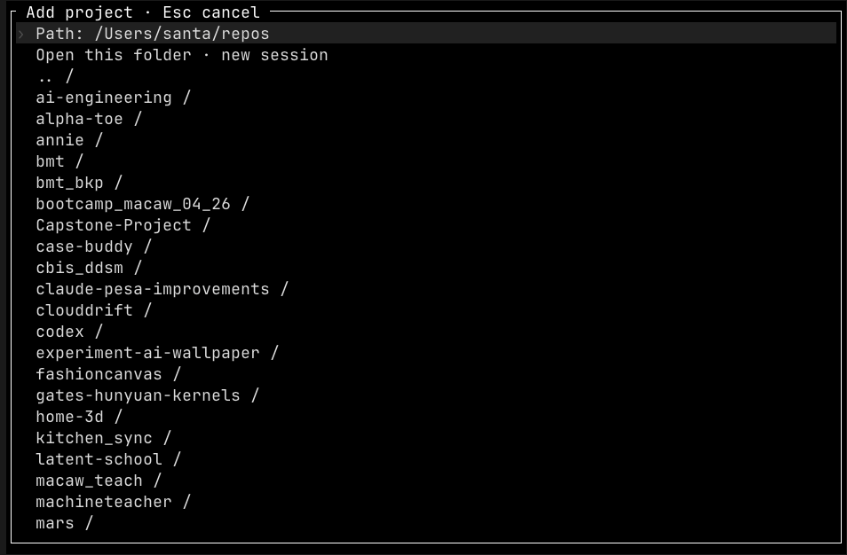

  
- auto move to new session while talking to manager 

- Manager your screen needs to look different - open with ctrl + x and "." . this also opens when gpt-live is initiated. but manager can be talked to by composer itself as well.  
- worktree merge should not ask for permission to merge 
- Auto delete worktree when done with it
- subagent screen/modal should look like the root agent except that there is back button which is the first two cols of TUI ( with a <-  in the center )  
- "Notice" needs to be better. We need to classify that there are two things that will be on the screen. One is we are showing the user one-to-one mapping of the context of the agent. Second one, things like notice should appear in a box, and there should be an X button to close them.
- Collapsed tools need to render better. For example, the shell tool, when uncollapsed, the first two lines should show the input, the 4 lines (scrolling) output. When clicked on input it should show the full input in a modal just in case if it's too big if it's more than say four lines.
- when a session is selected from the sessions modal, the modal should close.  /new
-  better way to render this
- a toggle to show tabs as vertical on the left sidebar(new)  
- new messages takes a second to show up ( remove the lag ) (same for steer to interupt promotion ) 
- 