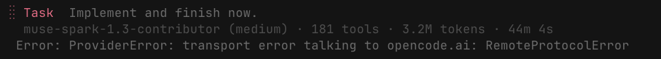
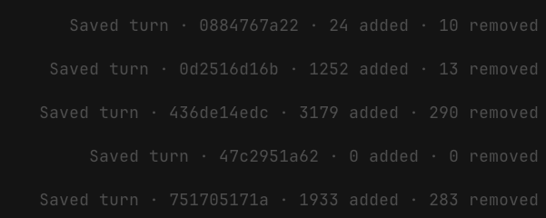

- Subagents could be launched in a non blocking way, which means that they are launched and root agent can be still talked to by the user, and when the sub-agent is done, it adds the resultant context into the root agent and we run again.  
- When sub-agents continue, we have to redesign the UI better that there is no spinning on both the instance and there is a connection on the left side by a faint colored line, the same color as the agent, that connects these two. And when user hovers over any one, the other also should highlight. But mostly both the spinners should not be spinning, only the latest instance
-  auto retry for this - and the ability for root agent to continue the subagent 
-  remove this