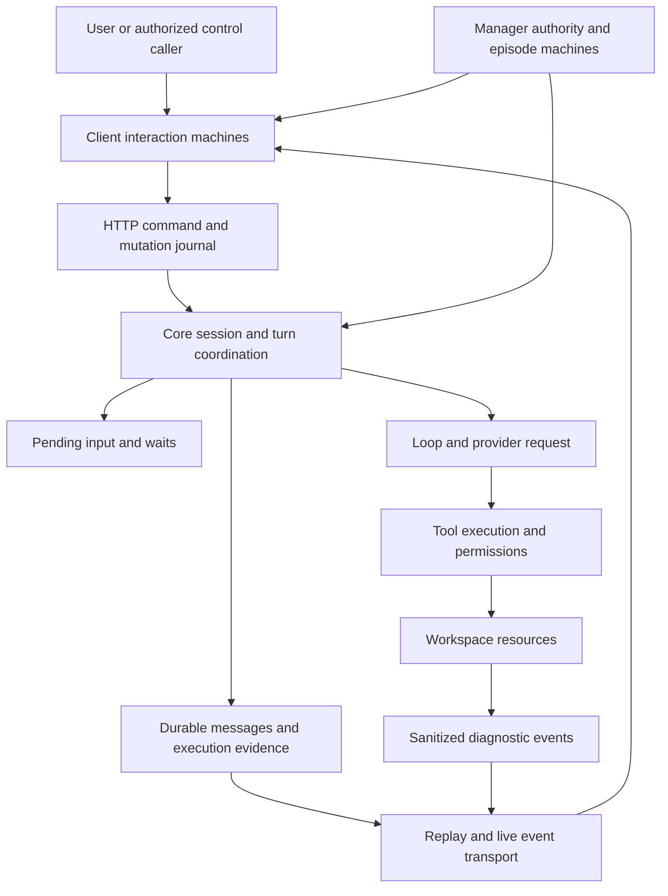
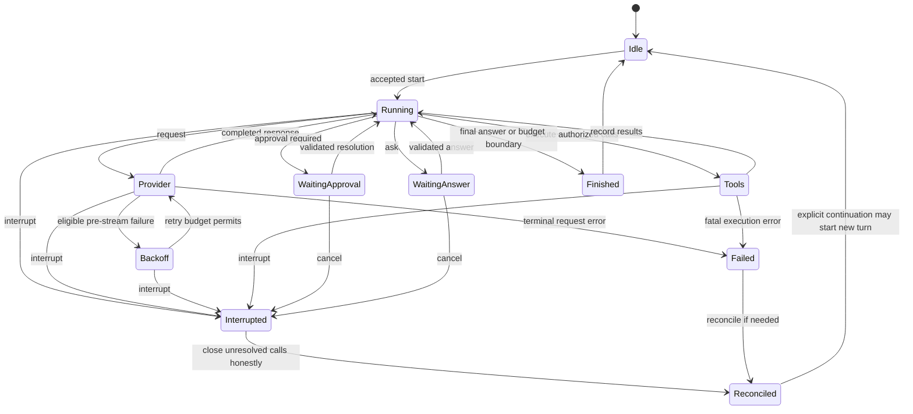
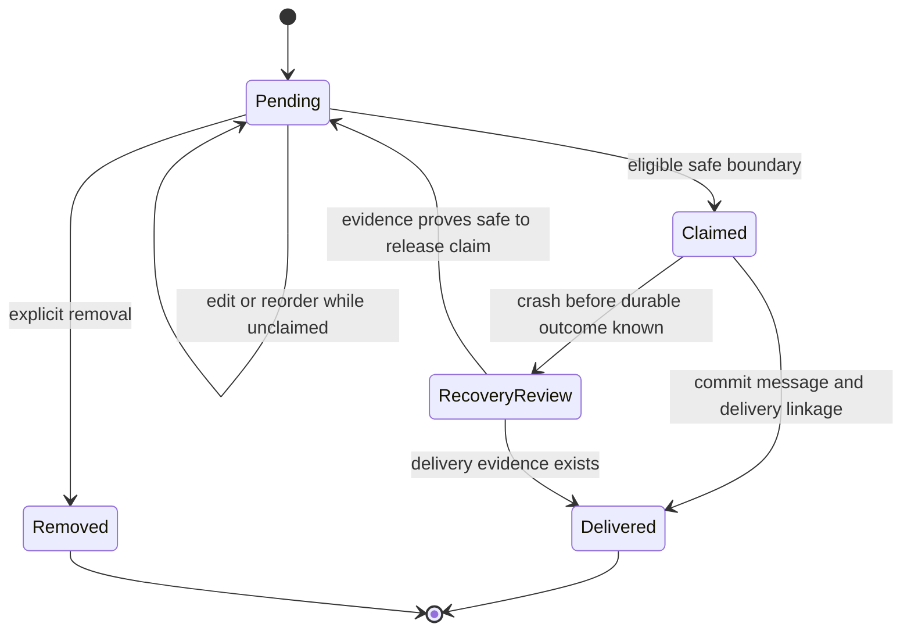
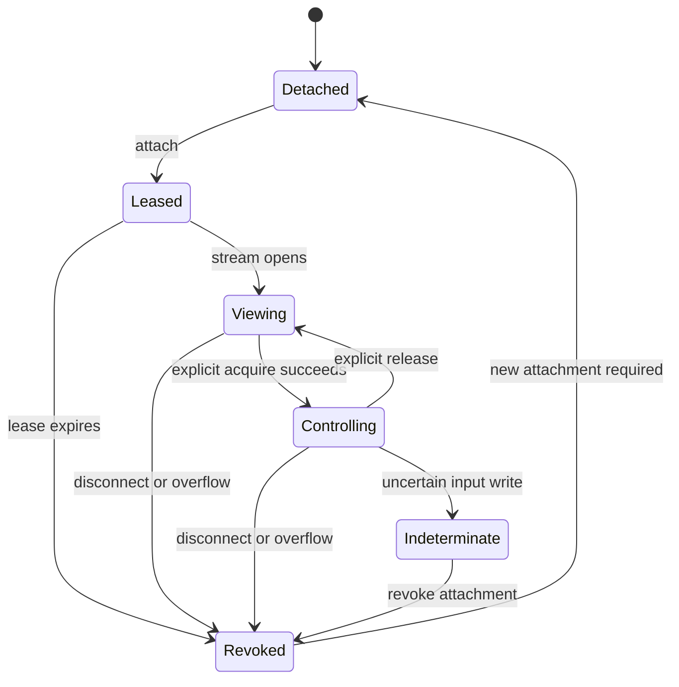
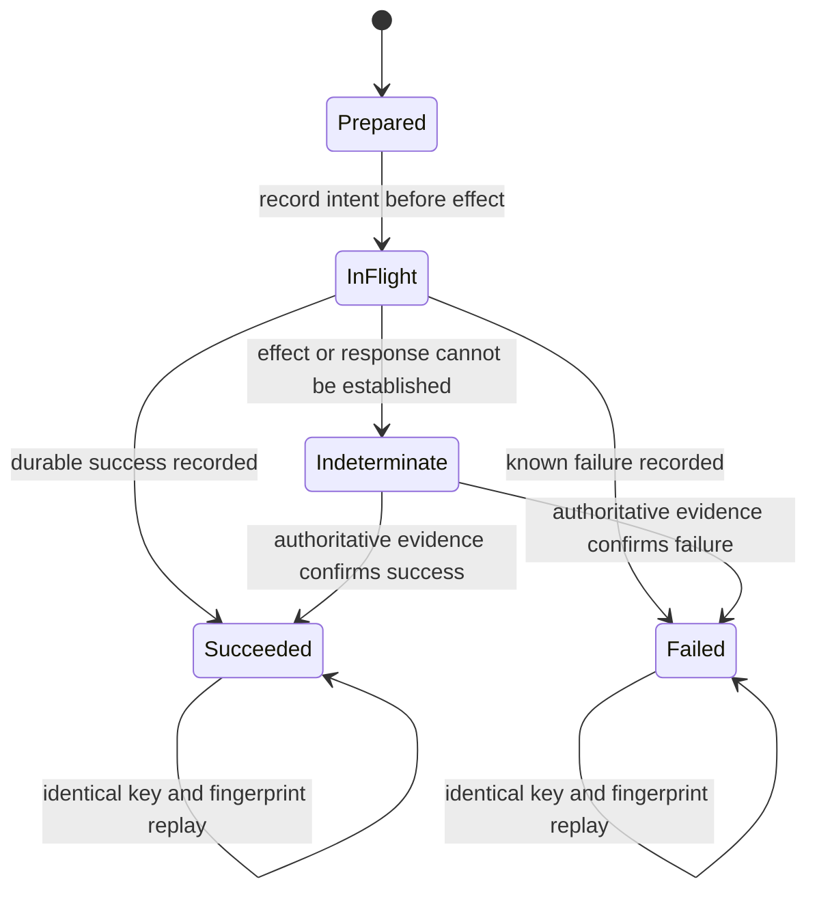
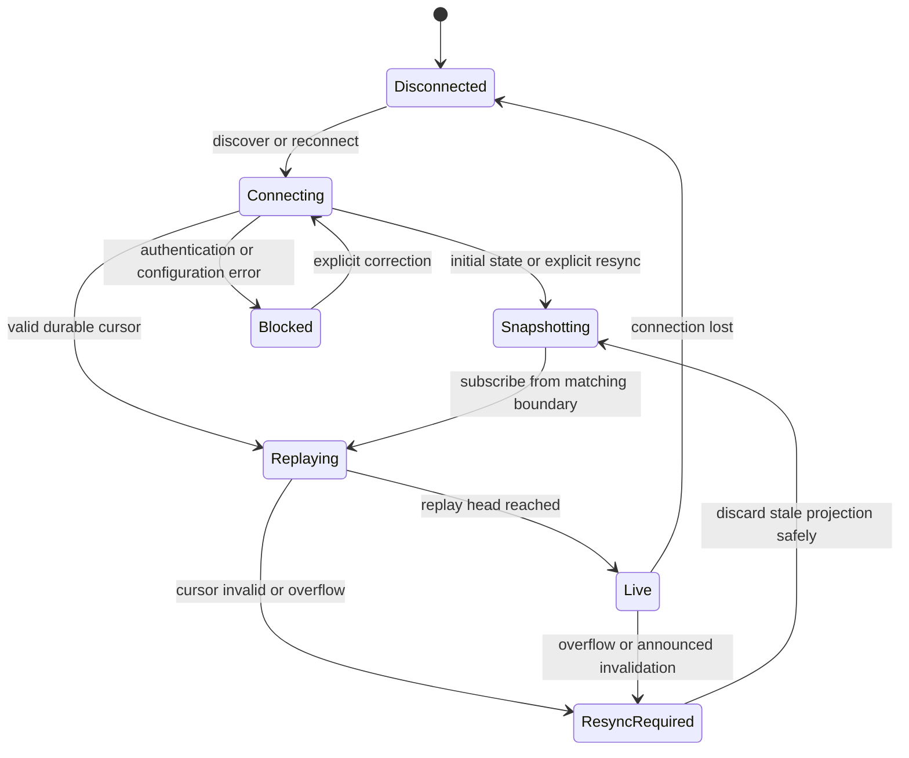
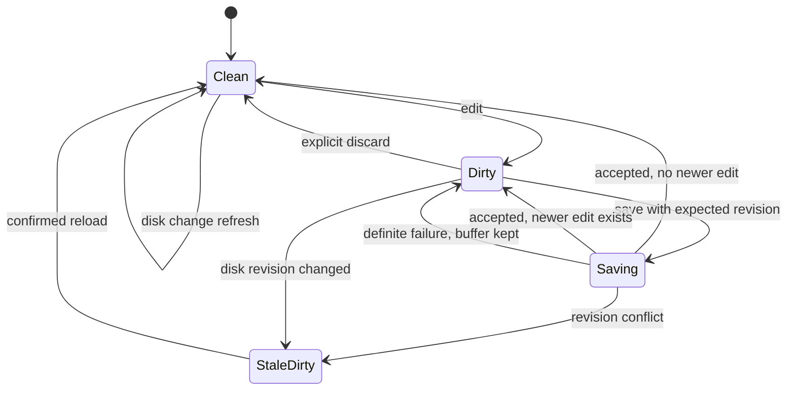
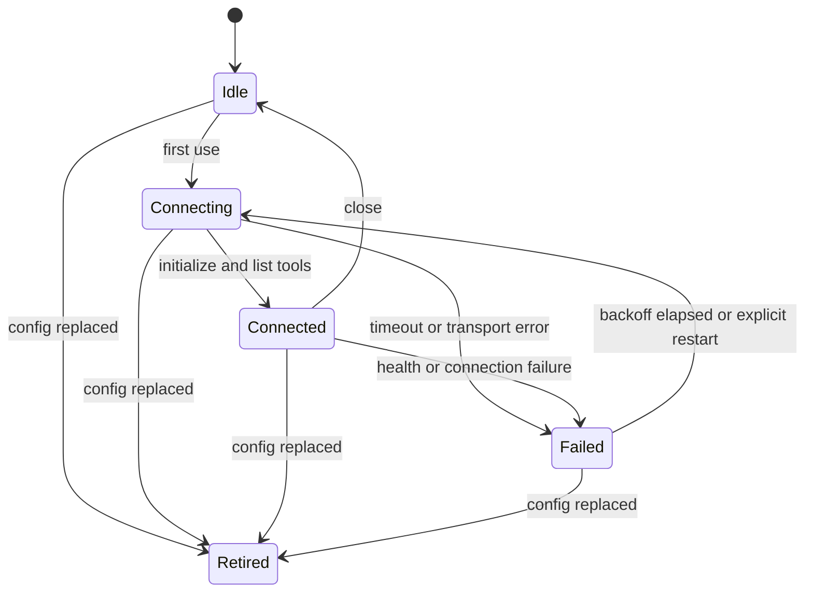
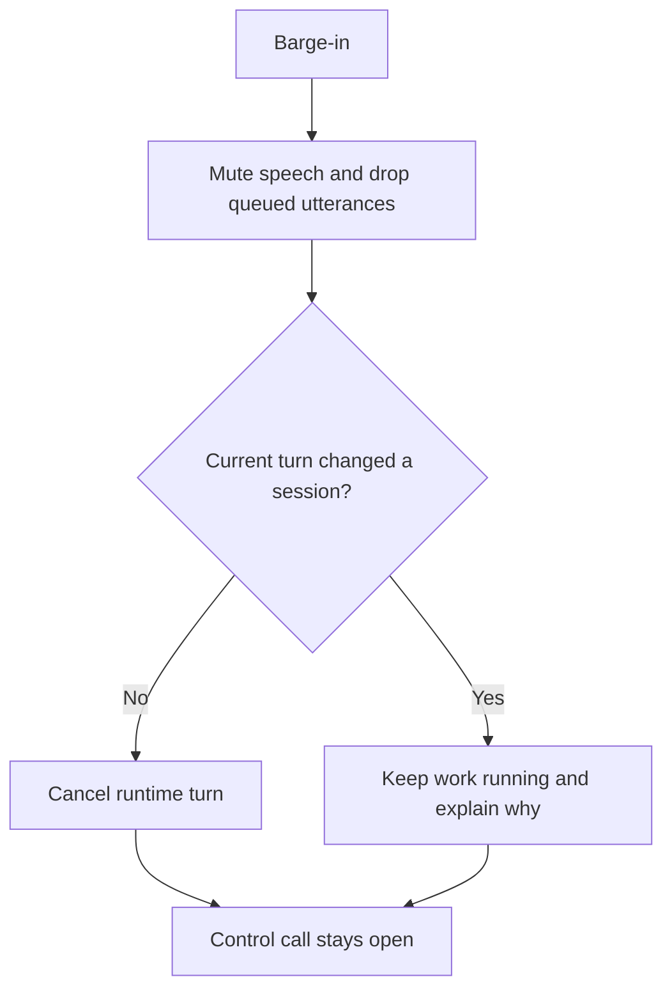

# Nexus state-machine audit and proposed direction

**Status: proposal for review only — no implementation approved or performed.**  
**Audit date:** 2026-11-09. **Baseline:** the current working tree, including existing uncommitted work.

## Executive decision

**Make the existing distributed state machines explicit at their ownership boundaries, incrementally. Do not rewrite Nexus around one global machine or introduce a mandatory state-machine framework.**

Start with the three boundaries where ambiguity is most costly: **turn/input/wait lifecycle, mutation outcome, and reconnect/resynchronization**. Preserve public statuses, event ordering, persistence, permission decisions and client behavior while extracting typed transitions and executable invariants. Only then consider user-visible improvements, in paired TUI/NSH changes.

This is the best joint UX/DX/AX direction because it makes the app explain what it is waiting for, gives developers one place to reason about each transition, and gives agents reliable outcomes without granting new authority. It is not a promise that every change improves all three automatically: each implementation must pass the acceptance gates below. Where a benefit would compromise safety or existing behavior, retain the current behavior and seek review.

### Scope and confidence

This is a repository-level inventory of **behavioral state-machine families**, not a count of every boolean, parser branch or UI widget. A machine exists when prior state changes which commands/events are legal, including machines encoded by task presence, futures, database rows, leases or revision tokens. Some families already have explicit status enums; the implicit part is their coordination with other state.

Sources: `PLAN.md`, the current docs index and relevant architecture docs, plus implementation inspection across Core, clients and integrations. Paths below are evidence/entry points, not claims that each entire module has been formally verified. Inventory transitions are normalized descriptions; they are **not new wire values**. Proposed diagrams are explicitly labeled. Runtime/platform behavior and exhaustive interleavings have not been verified in this audit. Deferred ZMX and browser plans are not treated as implemented features.

Existing dirty-tree changes, including session-status and `/btw` work, are not overwritten or treated as release-verified. This document alone is the deliverable; `PLAN.md` is intentionally not changed before review.

## 1. Ownership: several cooperating machines, not one status

**Ownership rules to preserve:**

- Core owns execution truth; clients own drafts, focus, selection, presentation and attachment lifetimes.
- Durable facts, ephemeral tasks, and UI projections are different lifetimes. Reconstructing one does not resurrect the others.
- A session's own turn can finish while children keep its aggregate status busy. Archive state is independent of execution state.
- A pending input is not model context until committed at a safe boundary. Diagnostic events are not automatically canonical messages.
- The ordinary session timeline reflects model context; Manager context has its documented exception. Keep wire visibility, announced clipping and compaction, and canonical context retention.
- TUI and NSH desktop/web remain peers. Mobile remains Sessions/Manager/Settings with compact approvals/questions and approved slash commands, not desktop tools.
- Task tools act on the workspace. Control-plane operations change Nexus state. Discovery, a card, remote output or a newly visible tool never implies permission.

## 2. Inventory: execution and durable state

| ID | Machine family and implementation evidence | Existing lifecycle / implicit coordination | Safest decision |
| --- | --- | --- | --- |
| E01 | Daemon discovery/start/stop — `nexus-core/nexus/daemon.py`: `discover`, `start`, `ensure`, `stop`; `doctor.py` | Absent → starting/registered → reachable → stopping → absent; stale PID, port conflict and code fingerprint are separate observations. | Model discovery evidence separately from reachability; never treat the registration file alone as readiness or start duplicate daemons. |
| E02 | Session execution/tree aggregation — `runtime.py`, `store.py`, `snapshot.py` | Creation freezes agent/context configuration; own turn and descendant activity jointly determine busy/idle. | Keep aggregate busy as a derived projection, not a replacement for own-turn lifecycle. |
| E03 | Turn/step/request/tool lifecycle — `runtime.py`, `loop.py`, `store.py` | A running turn spans requests, streaming, tool calls, waits and completion/failure/interruption. Task existence and durable execution records must agree. | Extract transition guards at existing boundaries before changing scheduling or concurrency. |
| E04 | Provider retry — `retry.py`: `RetryPolicy`; `loop.py` | Attempt → pre-stream transient failure → bounded delay → another attempt; receiving a stream event closes automatic-retry eligibility. | Preserve the no-retry-after-stream boundary; distinguish provider retry, mutation replay and explicit continuation. |
| E05 | Approval and permission — `permissions.py`, `runtime.py`, `loop.py` | Policy decision can deny, allow or create a pending approval; a future bridges human response to execution. Cancellation/restart invalidates the live wait. | Give each wait one owner and terminal resolution; stale or duplicate replies must not execute tools twice. |
| E06 | Questions — `questions.py`, `runtime.py`, `tools/` | Pending structured request → validated answers or cancellation; answers race interruption, disconnection and other clients. | Distinguish unanswered, abandoned and answered; never infer an answer from reconnect or timeout. |
| E07 | Queue/steer/hold — `inputs.py`: `Inputs`; `runtime.py` | Durable pending rows, mode and independent session hold; claim/start → delivery into canonical context, or removal. Claimed inputs cannot be edited/reordered. | Make claim and delivery boundaries explicit; preserve order, message provenance and exactly-once canonical insertion. |
| E08 | Mutation journal — `server.py` idempotency middleware; `runtime.py`, `store.py` | Intent recorded before mutation → executing → recorded response; a lost reply or crash can leave outcome uncertain. Fingerprint distinguishes identical replay from key misuse. | Preserve the journal; formalize uncertainty instead of treating network failure as rollback. |
| E09 | Restart recovery/reconciliation — `recovery.py`, `continuation.py`: `reconcile`; `runtime.py` | Persisted running work becomes interrupted/reconciled, not transparently resumed; unresolved calls require honest synthetic closure before safe continuation. | Keep recovery idempotent and evidence-based; never rerun an ambiguous side effect automatically. |
| E10 | Fork/subagent and parent notification — `runtime.py`, `continuation.py` | Launch → child running → settled → parent notified; parent lifecycle and child lifecycle differ. Fork capability and read-only limits differ from ordinary delegation. | Carry parent/child IDs and enforce limits in Core, not only in prompts or client affordances. |
| E11 | Context capacity, handoff, title and continuation — `counting.py`, `oneshot.py`, `runtime.py` | Context budget can trigger handoff/continuation; auxiliary one-shot requests must not execute returned tool calls. Only settled history is safe for certain derived requests. | Treat handoff as a separate operation, not a hidden retry or destructive truncation; retain provenance and failed handoff evidence. |
| E12 | Archive/restore, project remove/delete — `autoarchive.py`: `AutoArchive`; `runtime.py`, `store.py` | Archive is tree-wide and independent of busy status; blockers prevent archiving/removal. Unregister preserves data; delete is a different destructive operation; re-add can restore. | Centralize eligibility predicates without merging archive, remove and delete into one lifecycle. |
| E13 | Durable event replay/live — `eventlog.py`: `Stream`, cursor errors; `bus.py`; `client.py` | Validate cursor → bounded replay pinned at head → live; generation mismatch, retention floor, overflow and disconnect require distinct recovery. | Preserve atomic replay/live handoff and explicit resync; reconnection alone is not synchronization. |
| E14 | Retention/compaction — `retention.py`: `Retention`; `store.py` | Heavy payload expiry, finished-session compaction and prefix pruning have different eligibility and cursor effects; canonical context remains. | Keep independent lifetimes and announcements; protect unresolved recovery and mutation evidence. |
| E15 | Configuration revisions — `config.py`: `ConfigFile.patch`, `ConfigConflict` | Read revision → edit → compare supplied revision → atomic replacement or conflict; invalid TOML blocks editing. | Preserve stale-write rejection and secret restoration; do not overwrite a conflict by blindly refreshing and retrying. |
| E16 | Agent/extension/skill/catalog snapshots — `agents.py`, `extensions.py`, `skills/`, `snapshot.py`, `llmhub/catalog.py` | Discovery/cache freshness differs from frozen session definitions; edits can become available without retroactively changing historical context. | Name active versus available revisions explicitly; keep definition changes visible where they affect model context. |
| E17 | Home migration — `migrate.py`: `plan`, `migrate`; `paths.py` | Unclaimed home → confirmed plan → old home set aside → marked/adopted home; live daemon and filesystem failures block or require rollback handling. | Preserve backups and idempotent marker semantics; test only isolated homes, never exercise migration on the real home for this review. |

### Proposed conceptual turn model (not wire statuses)

This diagram deliberately omits per-tool parallelism and child turns. It is an ownership sketch, not a proposed single scalar enum. Interrupting an external side effect does **not** prove it was rolled back.

### Proposed pending-input model

`hold` and `queue/steer` are independent dimensions, not extra mutually exclusive states. Recovery must use actual transaction evidence; the diagram does not authorize assuming a claim was never delivered.

## 3. Inventory: workspace, resource and side-effect machines

| ID | Machine family and evidence | Existing lifecycle / hidden boundary | Safest decision |
| --- | --- | --- | --- |
| R01 | Workspace-tool exposure and directory moves — `workspace.py`, `runtime.py` | Entry tool → detailed control tools activated; requested directory change can remain pending until a safe boundary. Frozen starting directory differs from current directory. | Separate capability discovery from authority and mutation; acknowledge pending versus applied moves explicitly and preserve instruction provenance. |
| R02 | Worktree lifecycle — `worktrees.py`, `runtime.py` | Registered checkout → create/list/use/delete; dirty, main or session-used worktrees block deletion. Creating does not move the session or delete branches. | Revalidate under the existing worktree lock; retain separate create/move/delete commands. |
| R03 | Git operation safety — `git_ops.py`: `registered`, `_ensure_normal`, `action`, `index`, `discard`; `server.py` | Inspection → confirmation if required → lock and revalidation → action → refreshed status; merge/rebase/unmerged state blocks ordinary mutations. Push upstream proposal can go stale. | Bind confirmation to exact target and current facts; retain literal paths and fast-forward-only pull. An external Git process is outside the daemon lock. |
| R04 | File revision/save/mutation — `files.py`: `read_file`, `write_file`, `mutate_path`; `server.py` | Read revision → edited contents → revision check → atomic replace or stale-file error; exclusive creation/rename differ from save. | Preserve buffers on conflict, revalidate paths and permissions, and never silently overwrite changed files. Daemon serialization does not make external writes impossible. |
| R05 | File-watch leases — `file_watch.py`: `FileWatches` | Renewed client leases keep a root watcher alive; native watching can degrade to visible polling; expiry/release/shutdown stop tasks. | Keep lease time, watcher mode and content freshness separate; events invalidate caches rather than prove exact file content. |
| R06 | Kernel lifecycle and execution — `kernels.py`, `tools/code.py` | Lazy process/session state → execution → idle, with nested task-tool calls; interruption, crash or restart can lose variables or leave an uncertain execution. | Make generation/loss explicit; do not describe a restarted kernel as preserving Python variables. |
| R07 | Bash background jobs — `bash_jobs.py`: `Job`, `Jobs`; `tools/` | Spawn → running → exit/timeout/kill → retained output/completion notice; linked PTY and legacy pipe fallback have distinct capture behavior. | One process owner, one completion outcome; keep job IDs, scope checks, output clipping and canonical notices. |
| R08 | Terminal resource — `terminals.py`: `Terminal`, `TerminalService`; `terminal_api.py` | Running → exited, explicitly closed, or ended after Core restart. Metadata retention differs from live PTY/replay availability. | Keep resource lifecycle separate from dock visibility and viewer lifetime; restart never resumes a PTY. |
| R09 | Terminal attachment/control/input — `terminals.py`: `Attachment`, `control`, `input`, `detach` | Attach lease → stream viewer → optional single writer; expiry/disconnect/overflow revokes control. Per-attachment input sequence/digest makes only a narrow retry safe. | No automatic reacquisition or unacknowledged-input replay across attachments; expose indeterminate writes honestly. No agent terminal typing. |
| R10 | Terminal replay/parser — `terminals.py`, both terminal renderers | Bounded replay → live; discarded history produces explicit gap/reset. Retained bytes are not a lossless screen checkpoint. | Retain visible gap warning and parser reset; never claim the reconstructed screen is complete. |
| R11 | Explicit terminal evidence — `nexus-nsh/src/terminal-evidence*.ts`, `nexus-tui/src/terminal_panel.rs`; `docs/terminals.md` | Selection → immutable bounded preview → add to draft → ordinary send/queue/steer. Resource generation and destination can change meanwhile. | Freeze exact text/provenance; cancel is inert; adding evidence neither sends it nor grants interactive control. |
| R12 | Artifacts/images/pastes — `artifacts.py`, `images.py`, `pastes.py`; client attachment modules | Blob preparation/validation → draft attachment → accepted canonical parts; collapsed display differs from full model-visible content. | Keep identity, limits and canonical inclusion explicit; failed upload/validation must not silently drop an attachment. |
| R13 | Inspector/export projections — `inspector/`, `inspector_data.py`, `export.py` | Snapshot/page boundary → loading → projection; new events invalidate stale views; retention can replace diagnostics with markers. | Preserve consistent export boundaries and explicit omission markers; inspection is not a new context injection. |
| R14 | Provider usage/search/cache services — `provider_usage.py`, `searchservice.py`, `llmhub/catalog.py`; corresponding clients | Cached/absent → refreshing or service startup → fresh/degraded/error; per-provider failure need not invalidate other rows. | Separate freshness from operation status; retain last valid data with age/error where contract permits, without inventing quota availability. |

### Existing terminal authority contract, normalized

The terminal process runs independently of this diagram. Hiding the dock detaches; explicit Close terminates. A late control response must not re-enable input after exit. Existing sequence/digest acknowledgment rules are a good pattern to preserve, not replace with a generic retry helper.

## 4. Recommended contract for every extracted machine

A lightweight transition specification per owner is sufficient; use native Python types, Rust enums and TypeScript discriminated unions where appropriate. Do not require matching internal representations across languages.

| Contract field | Required meaning |
| --- | --- |
| Identity and owner | Resource/session/turn/request/wait ID; the component allowed to commit the transition. |
| State dimensions | Durable phase, ephemeral generation and derived presentation separated; enumerate legal combinations rather than multiplying all flags into one enum. |
| Trigger and guard | Which command/event is accepted, expected revision/generation, authorization and safety predicates. |
| Commit boundary | Which records change atomically, and which external effects cannot participate in that transaction. |
| Outcome | Accepted/pending, known success, known failure, or indeterminate; retain current API vocabulary initially. |
| Side effects | Scheduled only at the existing safe point; no hidden permission, tool rerun or context mutation. |
| Observability | Existing durable event/diagnostic projection, safe reason, correlation IDs; no secrets, raw terminal input or hidden-context leakage. |
| Termination/recovery | Who resolves/cancels waits, releases leases and locks, and reconstructs state after restart. |
| Compatibility | Existing wire values, ordering, defaults and historical records remain accepted until a separately reviewed migration. |

### Proposed mutation-outcome model

A lost HTTP response is a client observation, not proof that Core is indeterminate. Resolve through the existing journal when possible. A changed payload with the same key is a conflict, not a retry. Do not extend this diagram into a false global exactly-once guarantee for shell, Git, MCP or filesystem side effects.

### Proposed client synchronization model

Do not present this as already identical in every transport. Specify the existing snapshot/cursor handshake per client before extracting code. A new connection generation invalidates stale asynchronous replies; it does not erase local drafts or authorize replaying destructive commands.

## 5. Inventory: clients (TUI and NSH)

Static source inspection only; nothing was run. Do not treat internal enum parity as required: TUI and NSH should share **observable scenarios**, not identical internal types.

| ID | Machine and evidence | Lifecycle / hidden boundary | Safest decision |
| --- | --- | --- | --- |
| C01 | Connection and sync — `nexus-tui/src/state.rs` `ConnectionState`, `sync.rs`; `nexus-nsh/src/core/sync.ts` `ConnectionState`, `Sync` | Already explicit (starting, connecting, live, reconnecting, offline, auth_failed, incompatible). NSH adds `needSnapshot`, `everLive`, `epoch`. NSH deliberately stays live across a clean stream EOF. | Keep as is. Separate transport, synchronization and trust. Characterize the clean-EOF behavior before touching it. |
| C02 | Replay/resync — `reduce.rs`, `partial.rs`; `core/reduce.ts`, `livepartial.ts` | Snapshot → buffered/live events; duplicates ignored; rejected cursor/overflow/restart → fresh snapshot. | Preserve durable-versus-live-only semantics and announced gaps. |
| C03 | History paging — NSH `loadTurns`, `loadOlderMessages`; TUI `sync.rs` | Loading → loaded → loading older → exhausted/error; selection change supersedes reads. | Key every read by Core, session and request epoch. |
| C04 | Manager view reporting — NSH `core/view.ts` `ViewReporter` | Pending → in flight → acknowledged/retry, stream epoch guarded. | Keep as a hint, never authority; never log the stream id. |
| C05 | Navigation, focus, overlays — TUI `ui.rs` `Focus`, `View`, `OverlayKind`, `Dialog`; NSH `store.ts` `centre`, `picker`, `confirmDialog`, `drawer` | Many signals form one implicit product machine. Cancel must restore focus. | Apply navigation targets atomically; snapshot destructive targets when a confirmation opens. |
| C06 | Mobile capability — NSH `mobile.ts`, `store.ts` `phone`, `phonePage` | Three tabs; conversation is nested under Sessions. | Gate at dispatch and in Core, not only visibility. Add nothing desktop-only. |
| C07 | Composer submit — NSH `commands.ts` `sendPrompt`; `store.ts` `firstPrompts`; TUI `composer.rs`, `actions.rs` | Draft → (create session) → submit → accepted / rejected / unknown. | Keep the draft until authoritative acknowledgment; never blind-retry an unknown outcome. |
| C08 | Queue/steer editing — NSH `pendingInputs`; `ui/composer.tsx` | Edit/remove/reorder races with consumption. | Return conflict outcomes; never optimistically drop an item. |
| C09 | Attachments — `images.rs`, `annotate.rs`, `pastes.ts`, `images.ts` | Import → preview/annotate → attach → submit; collapsed text differs from sent text. | One immutable submission snapshot. |
| C10 | Scroll follow — `scroll-follow.ts`; TUI `sticky.rs`, `timeline.rs` | Following ↔ reading; first-send pin releases on reader movement. | Keep as tested pure policy, separate from session status. |
| C11 | File watch and editor — `file-watch.ts`; `store.ts` `OpenFile`, `saveFile`, `reloadFile`, `refreshChangedFile`; TUI `ui.rs` `FileEdit` | Content, request and external-revision state are orthogonal; dirty+saving is legitimate. | Keep revision preconditions and buffer preservation; add full-identity response guards (see risks). |
| C12 | Git view — `store.ts` `loadGitPage`, `openGitDiff`; TUI `ui.rs` `Confirmed` | Scope → refresh → status → diff → mutation → confirm. | Guard by Core/project/worktree/path/group plus epoch; never auto-retry destructive actions. |
| C13 | Terminal attach/control/input and evidence — `terminal-panel.ts`, `terminal-evidence*.ts`; `terminal_panel.rs` | See section 3; panel visibility is independent of process lifetime. | Keep attachment, control and input as separate machines. |
| C14 | Provider login and settings — `ui/settings.tsx`, `store.ts` `providerLogins`, `patchConfig`; TUI `prefs.rs` | Login pending → connected/failed/cancelled. Setting requested → confirmed/error. Local prefs differ from server config. | Show requested versus confirmed; scope late status by provider and attempt. |
| C15 | Dictation, voice assets, speech — TUI `dictation.rs` `Phase`; NSH `dictation-logic.ts`, `voice-state.ts`, `speech.ts` | Already explicit. NSH helper throws on invalid transitions; TUI ignores stale ones. Playback has a draining phase. | Test observable outcomes, not a unified policy. Status check never downloads; cancel invalidates late results. |
| C16 | Cues and alerts — `cues.ts`; TUI `ui.rs` `Alerts` | Live wait/completion cues; replay stays silent. | Keep causal event identity so cues are not duplicated. |

### Candidate races to characterize (static findings, not reproduced)

1. NSH `store.ts` `reloadFile` and `saveFile` completion guards compare path only; `refreshChangedFile` also checks project/session/revision. The same relative path in two projects could mix up state.
2. `openGitDiff` guards path/group only; `loadGitPage` is stricter.
3. `reloadFile` re-applies a captured file object; typing during reload or an A→B→A selection could be clobbered.
4. Preserve the good behavior that text typed during a save stays dirty.

## 6. Inventory: Manager, voice, auth and MCP

| ID | Machine and evidence (`nexus-core/nexus/`) | Lifecycle | Safest decision |
| --- | --- | --- | --- |
| M01 | Control-call ownership — `manager/service.py` `Call`, `start`, `_retire`, `_teardown`, `on_stream_closed` | None → active holder; same holder idempotent; new holder retires the old call; holder stream loss ends it. | Typed ownership transitions; keep identity checks and teardown outside the lock. |
| M02 | Utterance/turn — `_enqueue`, `_work`, `_run_turn`, `_set_phase` | queued → thinking → replying → idle; a sticky error survives idle. | Keep phase, outcome and last error separate. |
| M03 | Cancellation — `service.py` `cancel`; `manager/turn.py` `TurnState` | Barge-in mutes and drops the queue; cancels work only before a side effect (`acted`). | Highest-value invariant: stop speaking ≠ cancel work ≠ end call. Test the full cross-product. |
| M04 | Authority — `turn.py` `authority`, `RateLimiter`; `manager/tools.py` | Decision needs prior presentation, later utterance, matching fingerprint and explicit allow. | A scoped capability protocol, never a global "approved" flag. Typed refusal reasons. |
| M05 | Episodes — `_admit`, `rollover_reason`, `recap`, `_new_episode` | Rollover at admission → recap → linked episode; restart appends a fresh baseline. | Keep independent of call and audio lifecycle. |
| M06 | Attention, stage, navigation, consent — `manager/attention.py`, `stage.py`, `view.py`, `consent.py` | Eligibility predicates; stale card id is a no-op; navigation pending → acknowledged/refused/timeout. | Reuse requested-versus-confirmed everywhere; notifications never grant authority. |
| M07 | Live audio — `service.py` `live_start`, `live_stop`; `manager/live/voice.py`, `transport.py` | off → starting → live/failed, with stale-start identity fences; sideband reconnect with backoff; a failed send is `live_send_ambiguous`. | Keep peer, sideband, client audio and control independent. Never replay an ambiguous send. Add a typed audio lifecycle only after characterization tests. |
| M08 | STT — `voice/manager.py`, `voice/status.py` | Assets absent/downloading/ready; engine cold → loaded → inference → idle unload. | Separate assets, engine and inference; no implicit downloads. |
| M09 | Provider login — `server.py` `provider_login`, `login_tasks`, `login_states` | idle → pending → connected/failed; DELETE cancels then signs out. URL/code are parsed from notification text. | Separate login attempt, credential availability and request health. Add an attempt id and typed progress fields. |
| M10 | Device flow and refresh — `llmhub/auth/device.py`, `codex.py` `_refresh`, `auth/store.py` | Polling/slow_down → success/denied/expired; refresh under a store lock. | Keep deadlines and locked rotation; credential presence ≠ a valid request. |
| M11 | MCP connection — `mcp/manager.py` `Connection` | idle → connecting → connected → failed (5/15/30/60 s backoff) → retired on config edit; guards rechecked before spawn and call. | Type the states; keep lifecycle, config validity and catalog freshness separate. |

## 7. Review findings (hypotheses to test, not reproduced defects)

| # | Finding | Why it matters |
| --- | --- | --- |
| F1 | `Runtime.reply_question` closes the question before the durable publish, whereas approval `reply` publishes first. A publish failure might strand a waiting future. | Possible lost wait; add an injected-failure test before any reorder. |
| F2 | `started` is recorded before approval, so it does not prove a tool ran. | Never describe it as "ran"; recovery must keep "unknown". |
| F3 | The claimed-input phase is implicit in a nullable `turn_id`. | Clients cannot say "starting". Surface it as a projection. |
| F4 | `busy/idle` conflates own work, descendants and waits. | Clients and agents re-derive the reason. Add a derived projection, keep the old status. |
| F5 | Login progress is regex-parsed from human text. | Brittle for clients and agents. |
| F6 | NSH file/Git guards compare fewer identity fields than their sibling guards (section 5). | Possible cross-project state mix-up. |

## 8. Recommended sequence (each step independently shippable and reversible)

1. **Docs and tables only.** Turn the inventories above into per-owner transition tables (the contract fields in section 4). No code change.
2. **Characterization tests** around current behavior: cancellation cross-product, lost responses, persistence-failure injection (F1), recovery crash points, reused tool-call ids, stale-response guards (F6), late ACKs, reconnect.
3. **Typed transitions at existing owners** with guard checks, no new state storage and no wire changes. Order: Manager cancellation and call/voice identity → turn/wait/input → mutation outcome → auth attempt → MCP types → clients.
4. **Additive derived projection** (activity phase, wait reason, claimed input, delivery certainty) as new optional API fields. Old clients ignore them. Land in TUI and NSH together per the parity rule; mobile shows it only inside the existing status view.
5. **Persistence or schema changes**: only with migration tests, a user decision and a ledger row.

### Acceptance gates for every step

- No change to existing wire values, event ordering, permission decisions, defaults or stored data.
- No hidden model context, no automatic retry of a side effect, no automatic resume or reconnect that implies consent.
- Existing suites pass (Core, TUI, NSH, Ruff, Clippy), plus new characterization tests.
- **UX:** the user can tell what is happening, what is awaited and whether an outcome is known. **DX:** one documented owner and transition table per machine. **AX:** typed reasons and outcomes (including "unknown" and "refused") instead of prose. A step that cannot show all three, or that weakens safety, is deferred.

## 9. Decisions for you

| Question | Default if you do not object |
| --- | --- |
| Approve the incremental, no-framework direction? | Yes. |
| Approve an additive derived activity/wait projection in the API? | Yes, as optional fields after step 2. |
| Fix F1 (question reply ordering) once tested? | Only if the test reproduces it. |
| Tighten the NSH file/Git guards (F6)? | Yes, with tests; no visible behavior change. |
| Typed login progress replacing text parsing? | Yes, additive; keep the old fields. |

## 10. Non-goals

No global state-machine library, no rewrite of the loop or store, no new runtime dependency, no change to recovery semantics (reconcile, never resume), no new agent authority (including terminal typing), no mobile surface beyond the approved list, and no change to `PLAN.md` until you approve.

## Not verified

Nothing was executed: no tests, builds, clients or live services. The inventories come from reading code and docs and from three parallel read-only audits. The working tree already had uncommitted `/btw` and session-status changes, which this audit neither modified nor evaluated. Line-level claims (F1, F6) are hypotheses until tested.
