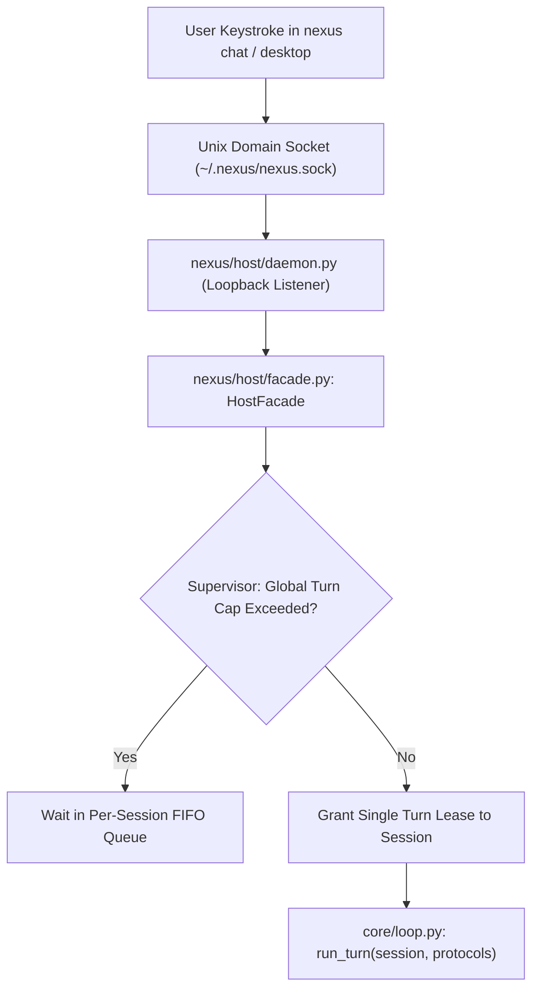
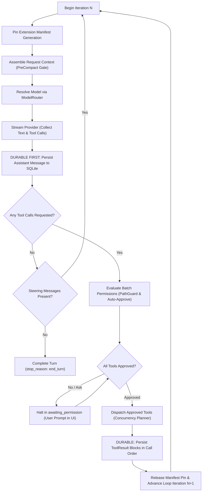
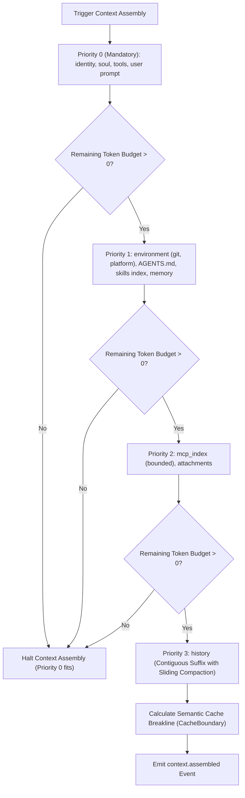
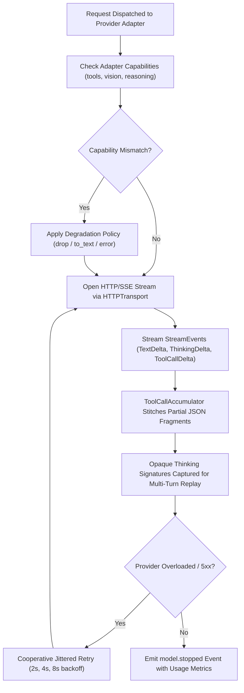
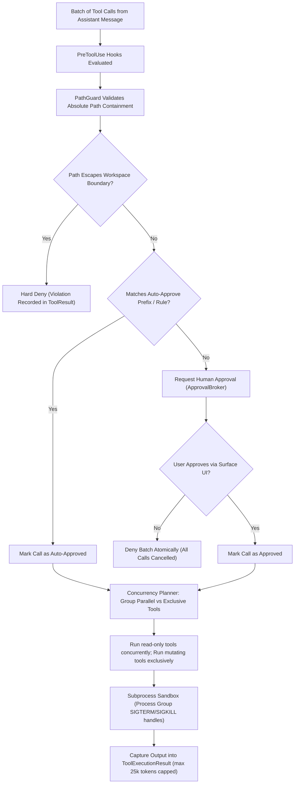
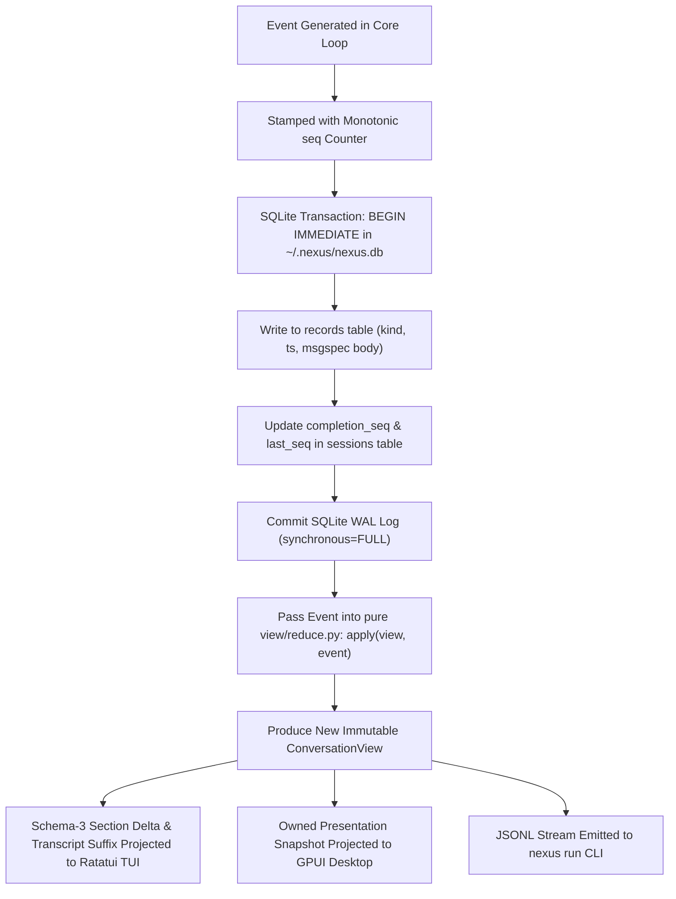
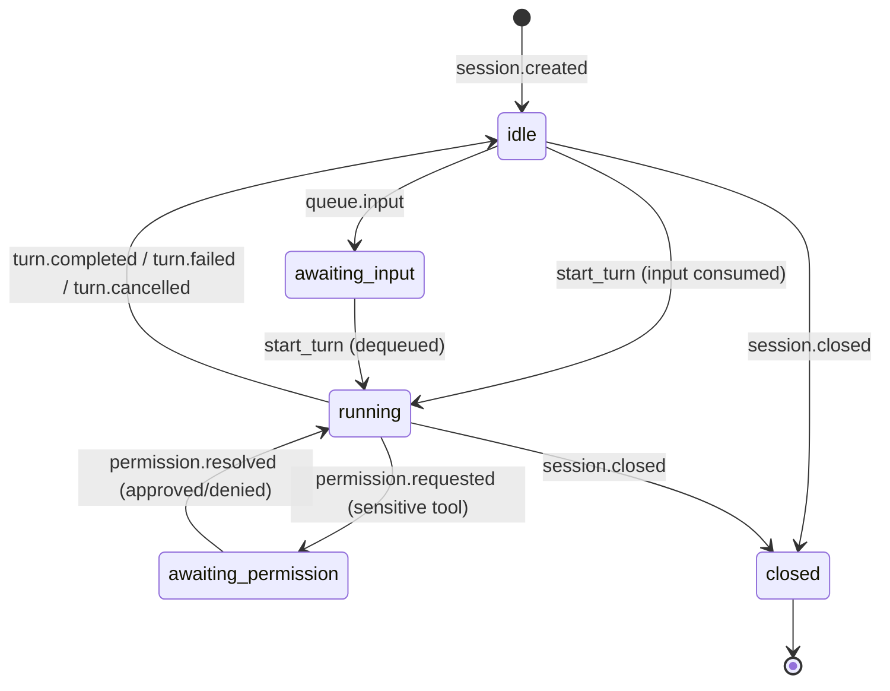
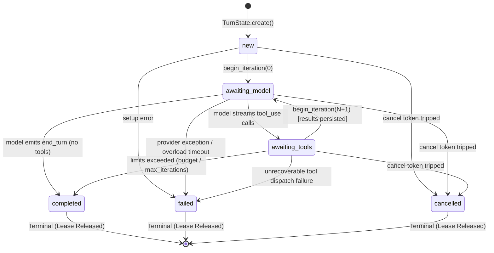

# Anatomy of Nexus: The Complete Architectural & Functional Guide

> [!NOTE]
> **The Anatomy Principle**: *The object is the explanation.* In the Anatomy methodology, we do not merely draw abstract boxes and arrows; we build and examine a precision mechanical instrument—**The Nexus Chrono-Dispatcher Console (Model 1)**—whose physical mechanisms map 1:1 onto Nexus's software contracts, durable logs, pure event reducers, and protocol-isolated execution loop.

---

## 1. What Nexus Is

**Nexus is a provider-agnostic Python agent harness built around absolute context transparency.**

In existing agent frameworks, context is often hidden behind black-box abstraction layers, buried in lossy wrappers, or dumped as raw unformatted JSON. Nexus exists on a different foundational premise:
1. **Clear Presentation**: Everything that matters—every tool parameter, command output, system prompt block, thinking trace, and token budget count—is clearly presented, labelled, structured, and legible to both the user and the agent. Nothing that the agent sees is hidden from the user.
2. **Workspace Daemon Ownership**: A single per-workspace daemon owns the session store, runtime managers, supervisor queues, and turn execution. Surfaces do not manage state; they connect as pure presentation clients.
3. **Multi-Surface Clients**:
   - **Native Ratatui Terminal Client (`nexus chat`)**: High-performance Rust terminal UI driven by schema-3 section deltas and transcript suffixes from Python.
   - **Rust GPUI Desktop Client (`nexus desktop`)**: Native GPU-accelerated desktop window receiving owned presentation snapshots.
   - **One-Shot CLI & Streaming Client (`nexus run`)**: Non-interactive command-line runner and raw JSONL event streamer.
   - **Browser Web Client (`nexus web`)**: Plain HTML/CSS/JS client connecting over loopback WebSockets (to be deprecated in favor of native terminal and desktop clients).

---

## 2. The Physical Embodiment: The Chrono-Dispatcher Console

To understand how Nexus works, inspect the physical machine:

```
                  ┌──────────────────────────────────────────────┐
                  │       TOKEN BUDGET DIAL INDICATOR            │
                  │   [0 - 200k Tokens · Radial Ticks · Needle]  │
                  └──────────────────────┬───────────────────────┘
                                         │ Brass Stanchion
                                         ▼
 ┌──────────────────────┐      ┌──────────────────┐      ┌──────────────────────┐
 │ CHRONO-SPINE DRUM    │      │  OPTICAL PRISM   │      │ GENEVA TURN TURRET   │
 │                      │ Tape │  (PURE REDUCER)  │ Fibers│                      │
 │ Append-Only SQLite   │─────►│ view/reduce.py   │─────►│ core/loop.py Loop    │
 │ Monotonic seq: 001.. │      │ Hex Quartz Block │      │ 4-Station Geneva Cam │
 └──────────────────────┘      └──────────────────┘      └──────────────────────┘
            ▲                            ▲                          ▲
            └────────────────────────────┴──────────────────────────┘
                        Milled Workspace Base Plate (Feet, Screws, Rulers)
```

### The Parts Vocabulary
* **The Solid Base Plate & Isolation Feet**: A heavy, vibration-damped milled slab with corner hex screws and tick rulers. It represents the strict **workspace boundary**: tools, file mutations, and local state are contained within the designated project root.
* **The Chrono-Spine Reel (Append-Only Event Store)**: A precision metallic tape reel that can only advance forward. Every lifecycle occurrence (`turn_start`, `text_delta`, `tool_call`, `tool_result`, `turn_end`) is permanently embossed onto the tape with an incrementing monotonic sequence index (`seq: 001`, `002`...). This embodies SQLite (`~/.nexus/nexus.db`). The reel is never overwritten; state is replayed deterministically from the tape.
* **The Pure Optical Reducer Prism (`view/reduce.py`)**: An elevated hexagonal quartz prism mounted on four brass corner pillars. As raw embossed event tape passes beneath it, the prism refracts the light into four distinct fiber-optic output channels:
  1. *Ratatui TUI Channel*
  2. *GPUI Desktop Channel*
  3. *CLI / JSONL Stream Channel*
  4. *Web Browser Channel*
  Because the prism is a pure optical element with zero internal state or memory, any re-projection of the event stream produces the exact same presentation across all four viewing screens.
* **The Geneva Turn Turret (`core/loop.py`)**: A 4-station Geneva indexing mechanism that drives the protocol loop without importing concrete managers:
  - *Station 1: Context Caliper* (`context/`): Measures token limits, compacts conversation history, and prepares the prompt IR.
  - *Station 2: Resonator Chamber* (`model/`): Swappable multi-model crystal head (Claude, GPT, Gemini, Ollama) that resonates with streaming text and thinking deltas.
  - *Station 3: Security Interlock Shutter* (`tools/permissions.py`): Mechanical safety gate that trips when a tool attempts to cross workspace boundaries or run unapproved shell commands.
  - *Station 4: Tool Dispatcher Carriage* (`tools/`): A sliding precision rail that actuates file edits, bash jobs, grep routines, and subagent worktree clutches.
* **The Token Budget Dial Indicator**: A top-mounted dial gauge with a fine needle indicating context window utilization (e.g. 42k / 200k tokens).
* **Front Controls**: A knurled rotary crown for model tiers (`fast`, `balanced`, `reasoning`) and a brass toggle switch with jewel LED indicating daemon lock state.

---

## 3. Strict Architectural Layers

Nexus enforces a strict **one-way downward dependency invariant** verified by automated tests (`tests/test_layering.py`):

```
L5   UI Layer          ui/, ui_support/, client/ (Ratatui, GPUI, CLI, Web)
                       │
L4½  Host Layer        host/, host_support/, observability/ (Facade, Daemon, UDS)
                       │
L4   Runtime Layer     runtime.py (Composition root, manager factory)
                       │
L3   Managers Layer    session/, context/, tools/, skills/, mcp/, agents/, hooks/
                       │
L2   Core Loop Layer   core/loop.py (Protocol-only loop, turn execution, event bus)
                       │
L1   Model Layer       model/ (IR, Provider protocol, Router, Registry, Tiers)
                       │
L0½  View Layer        view/ (Pure event reducer, ConversationView)
                       │
L0   Primitives        config/, errors.py, events.py, util.py
```

### The Invariants:
1. **No Layer Inversion**: `model/` never imports `core/`, `session/`, `context/`, `tools/`, or `runtime/`.
2. **Protocol Isolation**: `core/loop.py` imports zero concrete managers. It interacts strictly through interface protocols: `SessionViewProtocol`, `ContextAssemblerProtocol`, `ProviderResolverProtocol`, `ToolDispatcherProtocol`, `PermissionGateProtocol`, and `EventSinkProtocol`.
3. **UI Boundary Isolation**: Surfaces under `nexus/ui/**` may only import `nexus.host`, `nexus.view`, `nexus.events`, `nexus.client`, `nexus.host_support`, `nexus.ui_support`, `nexus.ui`, and the Python standard library. UI code never imports managers or touches database files directly (`tests/test_ui_layering.py`).

---

## 4. The Five Core Contracts

Five explicit frozen contracts govern communication across the system boundaries:

| # | Contract | Location | Description |
|---|---|---|---|
| **1** | **Message IR** | `nexus/model/message.py` | Canonical model-agnostic Intermediate Representation: `Text`, `Thinking(signature)`, `ToolUse`, `ToolResult`, `Image`, `Document`. Messages have `role: user \| assistant`. System prompts are assembled by `context/` and placed by provider adapters. |
| **2** | **Provider Protocol** | `nexus/model/provider.py` | Structural interface: `name`, `capabilities(model)`, `stream(req)`, `count_tokens(req)`, `aclose()`. The loop queries capabilities and adapts automatically. |
| **3** | **Stream Events** | `nexus/model/stream.py` | Granular streaming chunks: `MessageStart`, `TextDelta`, `ThinkingDelta`, `ThinkingEnd`, `ToolCallStart/Delta/End`, `Usage`, `MessageStop`, `Raw`. `ToolCallAccumulator` stitches partial JSON streams. |
| **4** | **Tool Contract** | `nexus/tools/spec.py` | `ToolSpec` (declaration schema, parameter definitions, harness options) and `ToolExecutionResult`. Tool execution contexts deliberately lack access to the `Runtime` to maintain encapsulation. |
| **5** | **Event Envelope** | `nexus/events.py` | `Event(type, data, seq, ts, session, turn, id)`. Monotonic `seq` per session forms the append-only spine. |

---

## 5. How It Works: Detailed End-to-End Execution Flowcharts

Execution proceeds through a series of deterministic pipelines across the 5 layers:

### Flowchart 5.1 · Ingress & Host Supervision


### Flowchart 5.2 · The Core Loop Iteration Engine


### Flowchart 5.3 · Context Assembly & Budget Priority Cascade


### Flowchart 5.4 · Multi-Model Streaming & Capability Degradation


### Flowchart 5.5 · Security Gate & Tool Execution Pipeline


### Flowchart 5.6 · Durable Storage & Pure View Reduction Pipeline


---

## 6. The Nexus State Machine Architecture

Nexus operates a strictly validated **dual-tier Finite State Machine (FSM)**. The two levels operate at different cadences but are unified through monotonic event reduction:
1. **The Session-Level FSM** ([`nexus/view/reduce.py`](file:///Users/santa/repos/nexus/nexus/view/reduce.py)): Models the client-visible conversational state across multiple turns (`idle`, `running`, `awaiting_permission`, `awaiting_input`, `closed`).
2. **The Turn-Level FSM** ([`nexus/core/turn.py`](file:///Users/santa/repos/nexus/nexus/core/turn.py)): Models the step-by-step execution within a single turn lease (`new`, `awaiting_model`, `awaiting_tools`, `completed`, `failed`, `cancelled`).

### 6.1 Session-Level State Machine (ConversationView)



### 6.2 Turn Execution State Machine (TurnState)

The core turn state machine is frozen, immutable, and strictly validated. Transitions are governed by `_ALLOWED_TRANSITIONS` in [`nexus/core/turn.py`](file:///Users/santa/repos/nexus/nexus/core/turn.py):



### 6.3 Transition Invariant Matrix

| From Phase | Allowed Next Phases | Forbidden Transitions | Primary Triggers & Invariants |
|---|---|---|---|
| **`new`** | `awaiting_model`, `failed`, `cancelled` | `awaiting_tools`, `completed` | Initial state. Cannot jump straight to tools or complete without an iteration. |
| **`awaiting_model`** | `awaiting_tools`, `completed`, `failed`, `cancelled` | `new` | Active LLM streaming. If model calls tools, moves to `awaiting_tools`. If model finishes text, moves to `completed`. |
| **`awaiting_tools`** | `awaiting_model`, `completed`, `failed`, `cancelled` | `new` | Tool dispatch phase. Re-entering `awaiting_model` requires `begin_iteration()` which advances the loop counter and pins a fresh manifest generation. |
| **`completed`** | *None* (Terminal) | All | `TurnStateError` raised if resurrection attempted. Stop reasons: `end_turn`, `tool_use`, `max_tokens`, `stop_sequence`, `budget`, `max_iterations`. |
| **`failed`** | *None* (Terminal) | All | Fatal harness exception or unrecoverable provider failure. Terminal lease released. |
| **`cancelled`** | *None* (Terminal) | All | Cooperative cancellation token tripped. Subprocess groups sent `SIGTERM` followed by `SIGKILL`. |

### 6.4 The Four Golden Invariants of the State Machine:
1. **Terminal Immutability**: Terminal states (`completed`, `failed`, `cancelled`) are mathematically frozen. A turn cannot be resumed or transitioned once terminated; fresh work requires a new turn.
2. **Durable Assistant Message First**: When transitioning from `awaiting_model` to `awaiting_tools`, the assistant's message containing tool uses is persisted to SQLite *before* any tool execution begins. If the daemon crashes during tool execution, resume sees a dangling `ToolUse` and appends synthetic error results instead of re-executing.
3. **Atomic Batch Permission Gate**: When a model calls multiple tools in one iteration, permissions are evaluated for the *entire batch* as an atomic unit. If user approval is needed, the session transitions to `awaiting_permission`. A denial cancels the whole batch, guaranteeing no half-executed batches.
4. **Manifest Pinning per Iteration**: Each iteration pins exactly one extension manifest generation. A tool or skill edited during iteration $N$ is only discoverable in iteration $N+1$, preventing race conditions and partial schema mismatches mid-stream.

---

## 7. What Nexus Does (Subsystems & Capabilities)

### 1. Multi-Model Provider Engine
Nexus supports dynamic, runtime model switching across providers without restarting sessions:
- **Built-in Adapters**: Anthropic (`claude-3-7-sonnet`, `claude-3-5-haiku`), OpenAI (`gpt-4o`, `o1`, `o3-mini`), Google Gemini (`gemini-2.0-flash`, `gemini-1.5-pro`), Ollama (local models), OpenRouter, and DeepSeek.
- **Tiers**: Semantic aliases (`fast`, `balanced`, `reasoning`) allow sessions to pick appropriate intelligence levels while decoupling prompt code from hardcoded model IDs.
- **Thinking IR**: Deep reasoning traces from thinking models are captured with opaque signatures and replayed verbatim without breaking context integrity.

### 2. Comprehensive Tool System
- **File System Operations**: Read, write, line replacement, directory listing, and glob matching.
- **Bash Execution**: Subprocess runner with output caps, sandbox isolation, background task tracking (`manage_task`), and interactive input piping (`send_input`).
- **Grep & Search**: High-speed regex matching across workspace files.
- **Git Operations**: Worktree branching, diff inspection, and repository awareness.

### 3. Subagents & Multi-Agent Swarms
- **Orchestration**: Sessions can spawn child agents via `invoke_subagent` and communicate asynchronously via `send_message`.
- **Git Worktrees**: Subagents can run in isolated git worktrees (`Workspace: "branch"` or `"share"`), allowing parallel code exploration without dirtying the parent worktree.

### 4. Extensions & Hot-Reload
- **Model Context Protocol (MCP)**: Native client support for external MCP servers over stdio and SSE.
- **Skills**: Discoverable markdown manuals and procedural playbooks (`.agents/skills/` and `skills/`).
- **Event Hooks**: Python hooks responding to lifecycle triggers (`on_turn_start`, `on_tool_execute`, `on_turn_end`).
- **Live Configuration**: Modifying `.agents/settings.toml` or workspace rules updates the daemon immediately without session drops.

### 5. Multi-Modal & Voice Capabilities
- **Local Dictation**: Fast speech-to-text transcription powered by local Whisper models.
- **GPT Live Voice**: Experimental real-time bidirectional voice calling over WebSockets.

---

## 8. Interactive Figure, State Machine Simulator & Pele Diagrams

The interactive SVG Anatomy figure, State Machine Simulator, and high-fidelity execution flowcharts are available in:
- **Interactive Console & Simulator**: [nexus_anatomy.html](file:///Users/santa/repos/nexus/human_docs/nexus_anatomy.html)
- **Build Script**: [build_nexus_anatomy.mjs](file:///Users/santa/repos/nexus/human_docs/build_nexus_anatomy.mjs)
- **Vendor Bundle**: [pele.global.js](file:///Users/santa/repos/nexus/human_docs/pele.global.js)

Open `nexus_anatomy.html` in any browser to interact with both the physical console, the live FSM, and vector flowcharts:
- Step through the execution cycle to observe the **State Transition Graph** update alongside the mechanical console.
- Trigger cancellation tokens or simulated harness errors to inspect terminal state invariants.
- Inspect legal vs forbidden transitions in real time.
- **Pele Diagram Engine (`pele@1`)**: All Mermaid flowcharts (5.1 – 5.6) and state machine graphs (2.1 – 2.2) are dynamically mounted via **[Pele](https://pele.run)**. In `nexus_anatomy.html`, Pele provides theme-adaptive vector SVGs styled to match the dark/light Anatomy design tokens, automatic viewport width adaptation (`autoDirection: true`, responsive breakpoints), and interactive pan-and-zoom controls (`zoom: 'auto'`).
