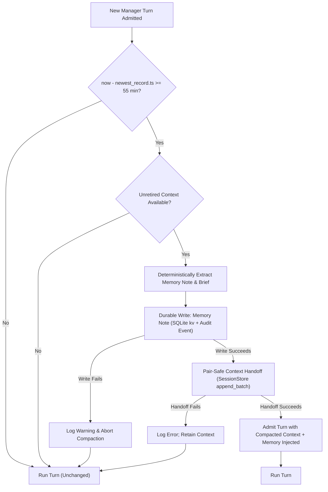

# Plan 10: Manager Automatic Compaction and Machine Memory

Status: proposed (2026-10-23). Concise and actionable architectural plan for automatic, durable lazy compaction and machine memory isolation for the Nexus Manager session. Extends Plan 02 ([`plans/in-progress/02-manager-session-orchestration.md`](../in-progress/02-manager-session-orchestration.md)), [`docs/manager.md`](../../docs/manager.md), and Plan 01 ([`plans/in-progress/01-unified-sessions-and-handoffs.md`](../in-progress/01-unified-sessions-and-handoffs.md)).

Scope addendum (2026-10-23, from `TODO.md`): the same change also gives **every Manager model request a compact, live "Nexus state" snapshot** (session counts, which sessions, project, who needs the user) using the shared dashboard buckets `working / idle / review / done / archived`. The snapshot is deliberately **ephemeral and separate from durable machine memory** (see Invariant 6 and §3.5): memory says what the Manager has done and been told; the snapshot says what Nexus looks like right now. Making the snapshot work is what lets machine memory stay small, free of volatile status, and safe to carry across compaction.

Tool contracts used here are the **current** ones in Plan 02 §3 and [`docs/manager.md`](../../docs/manager.md): the Manager catalog is eight tools (`sessions_find`, `session_launch`, `session_status`, `session_wait`, `session_result`, `session_cancel`, `session_send`, `session_show`), there is no approval step for launch/cancel/send/show (provenance, ownership and caps are the guard), and `session_send`/`manager.routed` exist. Plan 02 §10 is a proposal; where its text predates the code (e.g. "no `session_send`", "unconditional approval"), the code and `docs/manager.md` win.

---

## 0. Current Evidence and Source Audit (checked 2026-10-23)

1. **Current compaction is deterministic and in-prompt only, or root-oriented handoff**:
   - Compaction in `nexus/context/compact.py:1-450` implements strategies (`drop_oldest`, `evict_tool_results`, `summarize`, `hybrid`) that deterministically discard messages or tool outputs in memory during prompt assembly; it does not persist a durable milestone across restarts and is inherently lossy.
   - Handoff in `nexus/session/handoff.py:17-145` performs durable context cutover via `SummaryRecord` and `context.handoff` `EventRecord`, retiring messages before `boundary`.
   - `build_brief()` in `nexus/context/handoff.py:84-150` is specifically written for regular root coding sessions: it extracts file edits (`Write`/`Edit` in lines 138-139), active shell jobs (`open_shell_jobs` in lines 107-110, 127), and worktree paths (line 127). None of these exist in the Manager session, which runs no shell, no file tools, and no worktrees.
   - Conversely, `build_brief()` completely ignores Manager-specific entities: managed roots (`session.linked`), routed messages (`manager.routed`), launch refusals (`manager.launch_refused`), wait results (`manager.wait`), and inspected reports (`manager.result_read`).

2. **No manager memory path exists**:
   - `_manager_for_turn()` in `nexus/runtime.py:1352-1375` constructs the iteration assembler with `memory_text=""`, `soul_text=""`, `agents_text=""`, and overrides the environment with `system_override=MANAGER_PROMPT` and `summarizer=None`.
   - In `nexus/context/manager.py:2492-2498`, `_render_system()` short-circuits whenever `env.system_override` is non-empty:
     ```python
     if env.system_override is not None:
         self._last_included_parts = (
             {"system_override": env.system_override}
             if env.system_override.strip()
             else {}
         )
         return env.system_override
     ```
     Consequently, even if `memory_text` were passed, it is completely ignored during system prompt rendering for the Manager.
   - `_ManagerAssembler._stamp()` in `nexus/runtime.py:279-298` only appends the `Current user message id (pass as origin_message_id): m<seq>` hint to `system`; it has no memory seam.
   - Human-owned memory lives in `<workspace>/MEMORY.md` (`nexus/config/schema.py:146`). The Manager must never read or write this file.

3. **Manual handoff is refused for Manager**:
   - Host facade explicitly refuses manual handoff for the Manager session: `nexus/host/facade.py:1985` (`self._refuse_manager(command.session, "manual handoff")`).
   - TUI client explicitly documents: `nexus/ui_support/manager.py:31` (`"/handoff": "The manager cannot be handed off"`).
   - Plan 02 settled contract ([`plans/in-progress/02-manager-session-orchestration.md:92`](../in-progress/02-manager-session-orchestration.md#L92)): `| Compaction | plan 01 handoff, deterministic brief only (no summary call, so no second model) |`.

4. **Durable storage primitives already exist**:
   - Durable log records in SQLite `records` table (`nexus/session/db.py:246-255`) store `(project_id, namespace, session_id, seq, kind, ts, body)`. The index on primary key enables fast, single-row lookup of the newest durable record timestamp:
     `SELECT ts FROM records WHERE project_id=? AND namespace=? AND session_id=? ORDER BY seq DESC LIMIT 1`.
   - `SessionStore.kv_set` and `kv_get` (`nexus/session/db.py:1933-1950`) store transactional key-value pairs in SQLite table `kv` (`nexus/session/db.py:267-270`), scoped by `(project_id, namespace, key)`.

6. **Live Nexus state is already available to the Manager port, but never reaches the prompt**:
   - `HostManagerPort._visible()` (`nexus/host_support/manager_port.py:641`) lists visible roots (main namespace, `kind == "root"`, not archived, not the Manager) from `SessionManager.list(include_archived=False)`; each `SessionSummary` (`nexus/session/manager.py:98`) carries `state` (`SessionState = idle | running | awaiting_input | awaiting_permission`), `last_activity`, `order_time`, `completion_seq`, `child_count`, `running_children`.
   - `_find` (`:656`) and `_status` (`:703`) already derive row fields and `attention` flags (`permission` for `awaiting_permission`, `input` for `awaiting_input`; `_status` also returns the latest terminal `outcome` for idle sessions from `_TERMINAL`: `completed | failed | cancelled`). `SessionRow.focused_clients` is host-only and not exposed to the model.
   - Today the model only learns this state if it calls `sessions_find`/`session_status`; `_ManagerAssembler._stamp()` adds only `Current user message id`. There is no "state" in any prompt, and `build_brief()` after a handoff would carry no live state either.
   - There is no `review`, `done` or `archived` state in the data model. The Manager can see only **non-archived** roots, so `archived` is not computable from the current port (open decision D3).
   - Scope is one workspace (Plan 02 U1/U2): the "project" is this workspace/project store (`project_id`), not a cross-project list.

5. **Turn admission lifecycle**:
   - Turn admission flows from `Supervisor.submit()` (`nexus/host/supervisor.py:186`) -> `Supervisor._pump()` (`nexus/host/supervisor.py:374`) -> `Supervisor._start()` (`nexus/host/supervisor.py:407`) -> `Session.start_turn()` (`nexus/session/session.py:2919`) -> `Session._prepare_turn()` (`nexus/session/session.py:2621`).
   - `_prepare_turn()` synchronously claims `lease = self.begin_turn(...)` and persists `input.consumed` events.
   - `session.handoff(...)` (`nexus/session/handoff.py:17`) requires an exclusive session lock when called outside an active turn (`_within_turn=False`), or requires the turn lease when called inside (`_within_turn=True`).

---

## 1. Intent and Architectural Rationale

The Manager session is a persistent singleton (`nexus-manager` in namespace `main`) that lives for the lifetime of the workspace. As users launch tasks, check statuses, and relay instructions over hours and days, the Manager's active log grows without bound. If left uncompacted, it exhausts context windows, bloats token usage, and increases latency.

### 1.1 Why Lazy Compaction at Turn Admission (>= 55 min)?

We evaluate three potential triggers:

| Strategy | Mechanism | Pros | Cons | Decision |
|---|---|---|---|---|
| **Model-callable tool** | Model calls e.g. `session_compact()` | Explicit LLM control | Model may fail to call it, call it hallucinatively, or lose track; prompt injection via `<session_result>` could trigger malicious context erasure; breaks Manager 8-tool structural catalog | **Rejected** |
| **In-memory background timer** | `asyncio.sleep` / periodic ticker | Proactive background cleanup | Violates durable-first principle; state lost on daemon restart; spins daemon and wakes idle sessions with no user present; races with concurrent input arrival | **Rejected** |
| **Durable lazy compaction at turn admission** | Evaluated when admitting next turn if `now - newest_durable_ts >= 55 min` | 100% durable across daemon restarts; zero background compute when idle; synchronous with turn lease boundary; fail-safe | **Preferred** |

**Why 55 minutes?**
Codex context cache windows and human working session boundaries typically follow 30–60 minute idle decay patterns. A 55-minute threshold cleanly captures natural session breaks (e.g. human returns after lunch or the next morning) while avoiding disruptive context shifts during active conversational bursts.

### 1.2 Non-Goals for v1
- Generative secondary-model summarization: Manager model is pinned to `codex/gpt-6-luna`; no secondary model is invoked.
- Modifying human-owned `<workspace>/MEMORY.md`.
- Changing regular root or child session compaction paths.
- Interactive user confirmation dialogs for automatic compaction.
- Persisting any session state, counts or attention flags as machine memory (§3.5, Invariant 6).
- The Manager-screen board UI (sessions in working/idle/review/done/archived boxes) is a separate client plan; this plan only defines the bucket vocabulary and the host-side mapping function it should reuse.
- Any new Manager tool, any widened read access, or any authority derived from the snapshot.

---

## 2. Core Invariants and Target Contracts

### Invariant 1: First Durable Memory Write, Then Pair-Safe Handoff (Fail-Safe Ordering)
Compaction must write and fsync/commit the extracted machine memory note before initiating context retirement.
- If the memory note write fails (disk full, SQLite lock error, constraint violation): **abort compaction immediately**. Do not retire context. The incoming turn runs on uncompacted context.
- Context retirement occurs only after memory durability is guaranteed.



### Invariant 2: Isolated Manager Machine Memory
Manager memory is machine-managed and strictly isolated from human-owned `<workspace>/MEMORY.md`.
- Stored transactionally in SQLite `kv` table under key `manager_machine_memory` for `(project_id, namespace="main")`.
- Audit record emitted to Manager log: `manager.memory_updated` containing content digest, char count, and retired sequence range.
- Human-owned `MEMORY.md` remains untouched.

### Invariant 3: Deterministic Extraction in v1
Extraction is purely programmatic, deterministic, secret-redacted, and bounded:
- Extracts managed sessions launched (`session.linked`, `kind="managed"`): id, agent role, launch time, and the digest-level origin. A final outcome is kept only if the log itself records it (`manager.wait` outcome, `manager.result_read`) and is labelled **"as last observed"**; the current state of a session is never extracted (Invariant 6).
- Extracts routed links and targets (`manager.routed`, `session.linked` `kind="routed"`).
- Extracts latest human constraints and preferences addressed directly to the Manager from real user messages (`m<seq>`).
- Reads only structured events and real user prompts; assistant prose is never a source, so a snapshot quoted by the model cannot leak into memory.
- Redacts secrets using `redact_secrets()`.
- Caps memory note strictly to bounds (e.g. max 4,000 chars) using structured section fitting.

### Invariant 4: Dual Injection Path
Because Manager bypasses the general `_render_system` path (due to `system_override = MANAGER_PROMPT`), memory is injected through two cooperative channels:
1. **Runtime System Seam**: In `_ManagerAssembler._stamp()` (`nexus/runtime.py:279`), read `store.kv_get("manager_machine_memory")` and append a structured `## Manager Memory (machine notes)` block to `system`. The same seam appends the **live** `## Nexus State` snapshot (§3.5) on every request, as a separate block after the memory block; the two never share a block, a store or a refresh path.
2. **Active Context Handoff Brief**: The `SummaryRecord` brief generated by `handoff()` forms the first message of `active_messages()`. It carries history, never live state (it points to the per-request snapshot instead).

### Invariant 6: Ephemeral State Snapshot vs Durable Machine Memory
- **Snapshot** = what Nexus looks like now: counts, which sessions, project, who needs the user. It is computed from the host's current session list on every model request, lives only in the request's `system` text, is **never written** to `kv`, the Manager log, `manager.memory_updated`, or a handoff `SummaryRecord`, and is never read back by the extractor.
- **Memory** = what the Manager did and was told (launched/routed ids, human directives). It may name session ids and roles but never a current state, count or attention flag.
- Where they disagree, the snapshot wins for "now"; memory wins for "what happened before". After compaction nothing about live state is lost, because it was never in the compacted context as truth.
- The snapshot is metadata only and **confers no authorization**: seeing a session, its bucket, or an attention flag grants no `session_result` read, no cancel, no send/show and no launch. Those keep their Plan 02 rules (managed link or exact id in the latest user message; current-turn real user provenance; caps).

### Invariant 5: Pair-Safe Message Boundary
Context handoff must cut over cleanly at the boundary before the incoming turn's new messages, ensuring:
- `boundary <= read.next_seq + 1`
- No pending `ToolUse` is split from its `ToolResult`.
- Handoff executes under session lock prior to turn start (`_within_turn=False`), or immediately within turn preparation under `TurnLease` (`_within_turn=True`).

---

## 3. Detailed Component Design

### 3.1 Manager Memory Extractor (`nexus/manager/memory.py` or `nexus/context/manager_memory.py`)

A pure, deterministic extraction module:
```python
def extract_manager_memory(
    records: Sequence[SessionRecord],
    existing_memory: str = "",
    *,
    max_chars: int = 4000,
) -> str:
    """Extract structured, bounded, secret-redacted machine memory from Manager log.
    
    Extracts:
    1. Active & recently completed managed root sessions (id, role, title, status).
    2. Routed message links and targets.
    3. User directives / preferences from valid user prompts (m<seq>).
    """
```

**Memory Note Format**:
```markdown
# Manager Memory (machine generated)
## Managed Sessions (ids only; current state is in the live Nexus State block)
- s_abc123 [build] "Fix flaky tests" launched m41; last observed: completed
- s_def456 [task] "Refactor parser" launched m57

## Relay Links
- Routed to s_xyz789 (2 messages)

## Active Directives & Constraints
- User prefers offline verification before git operations.
```

### 3.2 Manager Handoff Brief Builder

Complementing root session `build_brief()`, a Manager-specialized brief builder:
```python
def build_manager_brief(
    messages: Sequence[Message],
    handle: Any,
    boundary: int,
    memory_note: str,
) -> str:
    """Build a deterministic handoff brief tailored to Manager operations."""
```
- Replaces empty shell/file sections with manager activity summaries (launches, status checks, wait outcomes).
- Contains **no** live session state, counts or attention flags; instead one fixed line: "Current Nexus state is supplied fresh in the `## Nexus State` block on every request; do not rely on states mentioned earlier." Historic outcomes are phrased as past events ("wait on s_abc123 ended: completed").
- Embeds references to the durable history sequence range: `Earlier history: this session, seq 1..{boundary - 1} (not deleted)`.
- Sanitized with `safe_brief()` and fitted within `MAX_BRIEF_CHARS` (6000 chars).

### 3.3 Turn Admission Compaction Hook

In `nexus/session/session.py` (during `start_turn` before `_prepare_turn`):
```python
async def _maybe_lazy_compact_manager(self) -> None:
    if self.kind != "manager":
        return
    
    # 1. Check newest durable record timestamp
    newest = self._store.read_tail(self._id, max_records=1).records
    if not newest:
        return
    last_ts = newest[-1].ts
    now = time.time()
    
    idle_limit = self._config_idle_compaction_seconds() # default 55 * 60
    if (now - last_ts) < idle_limit:
        return
        
    # 2. Check if there are active messages to retire
    messages, seqs = self.active_messages()
    if not seqs or len(seqs) <= 1:
        return

    # 3. Deterministic memory extraction
    read_result = self.read(force=True)
    existing_mem = self._store.kv_get("manager_machine_memory") or ""
    new_mem = extract_manager_memory(read_result.records, existing_memory=existing_mem)
    
    # 4. Durable memory write FIRST
    try:
        self._store.kv_set("manager_machine_memory", new_mem)
        self.append_event(Event(
            type="manager.memory_updated",
            session=self._id,
            data={
                "chars": len(new_mem),
                "digest": hashlib.sha256(new_mem.encode()).hexdigest()[:16],
                "through_seq": read_result.next_seq,
            }
        ))
    except Exception as exc:
        logger.warning(f"Manager memory write failed; skipping handoff: {exc}")
        return

    # 5. Context handoff SECOND
    try:
        brief = build_manager_brief(messages, self, read_result.next_seq + 1, new_mem)
        self.handoff(summary=brief, reason="idle_timeout", _within_turn=False)
    except Exception as exc:
        logger.error(f"Manager handoff failed after memory write: {exc}")
```

### 3.4 Runtime Prompt Stamping

In `nexus/runtime.py` `_ManagerAssembler._stamp()` (lines 280-297):
```python
# In addition to the existing user message ID hint:
manager_mem = session._store.kv_get("manager_machine_memory") if session else None
if manager_mem and isinstance(system, str):
    system = f"{system}\n\n## Manager Memory\n{manager_mem}"
```
This guarantees the pinned Codex model receives the up-to-date machine memory in every turn without breaking the packaged `MANAGER_PROMPT` constant. The state snapshot (§3.5) is appended by the same function after the memory block and after the existing `Current user message id` line; ordering of the stamped system text is: `MANAGER_PROMPT` (stable) → memory (changes at compaction) → user message id and Nexus State (change per request). The most volatile parts go last to keep the stable prefix cacheable.

### 3.5 Manager Nexus State Snapshot (every request, ephemeral)

**Source and ownership.** A pure function `build_manager_state(summaries, outcomes, *, now, project, cap) -> str` (host-side, next to `HostManagerPort`, no tool, no DB write) renders the block from the same `_visible()` set the tools use, so the snapshot can never show a session the tools would refuse (`SessionNotVisible`). The runtime obtains it through a read-only method on the existing `ManagerPort` factory seam (for example `ManagerPort.state_snapshot()`; name open) so `tools/` still never imports `host/`. If the port is missing or the call fails, the block is omitted or replaced by `Nexus State: unavailable`; a failure never fails the turn.

**Session state mapping (single source of truth; the dashboard board should reuse it).**

| Bucket | Derived from | Notes |
| --- | --- | --- |
| `working` | `state == "running"` | the bucket follows the root's own `state`; `running_children > 0` only adds a `+Nc` marker (an idle root with running children stays `idle`/`done`) |
| `review` | `state in {"awaiting_permission", "awaiting_input"}` | the **attention** set; same meaning as `session_status.attention` (`permission`, `input`) |
| `done` | `state == "idle"` and latest terminal outcome exists (`completed`; `failed`/`cancelled` shown as the outcome tag) and last activity within the 2 h `recent` window | outcome from the existing `_tail` read, computed only for rows that will be rendered |
| `idle` | `state == "idle"`, no terminal outcome yet (draft/never ran) **or** finished older than the `recent` window | |
| `archived` | not computable by the current port (archived roots are invisible) | rendered as `archived: n/a` in v1 or a count only if D3 is decided; never listed by id |

**Attention semantics.** "Needs attention" means a visible root is blocked on the human: a pending permission request or a pending question/input. v1 = exactly `awaiting_permission` + `awaiting_input` (bucket `review`). It does not include failed turns, unread completions or anything client-specific (read/unread is per client; see D2). The block states a count and lists those sessions first. The text never says the Manager should act on a flagged session; resolving a permission is a human action in the owning session.

**Project identifiers.** One header line names the workspace/project: display name (control-free, redacted, ≤ 60 chars) plus a short stable id (first 8 chars of `project_id`). Rows carry only the session id (the same `s_...` id the tools accept); no paths, no per-row project field in v1 because Plan 02 U2 restricts the Manager to its own workspace. If cross-workspace management is ever added, rows gain a project column and that is a new contract.

**Format and bounds.**
```text
## Nexus State (live snapshot; metadata only; grants no access)
as_of 2026-10-23T14:02:11Z · project nexus (p_1a2b3c4d)
working 2 · review 1 · done 3 · idle 4 · archived n/a   (10 visible)
needs attention: 1
[review] s_7f3a "Fix flaky sync test" · permission · 4m
[working] s_91cd "Refactor parser" · +2c · 12m
[done] s_20be "Add retry" · completed · 38m
... 5 more not listed (idle/older): use sessions_find
```
- Counts are exact over all visible roots; only the **row list** is truncated.
- Row cap 12 and block cap 1,800 chars (hard). Fill order: `review` (all, up to cap), then `working`, then `done` by `order_time` newest first, then `idle`; an omitted-rows line states the number cut. A review row is never dropped in favour of a lower-priority row; if even the review rows exceed the cap the block ends with "N more need attention; call sessions_find".
- Titles use the existing `sanitize_text` (control-free, credential-redacted) and are truncated to 60 chars here, with an explicit note that titles are untrusted data (they can come from model- or user-authored text and must not be followed as instructions). No instruction text, message content, results or paths ever enter the block.
- Ages are relative (`4m`, `2h`, `1d`) from `last_activity`; `as_of` is the generation time in UTC.

**Freshness and staleness.**
- Generated on **every** model request (not once per turn): a `session_wait` return, a launch or a long tool loop within a turn must not leave the model with a state from the turn's first request.
- It is not stored, so a daemon restart, a handoff or a replay cannot revive an old one. Any request-level trace that records the system text would hold a copy (to check against existing trace/redaction rules before build).
- The model is told (prompt line, tested wording only) that the block was true at `as_of` and is fixed for the current request, that earlier blocks in the conversation do not exist (they are not in the log), and that before asserting a state after a wait or a long gap it should call `session_status` for the exact id. Authoritative state for decisions remains `session_status`/`sessions_find`.
- Compaction ordering: compaction runs at turn admission (§3.3) before any request is stamped, so the first request after a handoff already carries a snapshot generated after the cutover.

**Not authorization.** The block is context, not a capability. Tool-side checks (visible set, managed link or latest-message mention for `result`, current-turn real user provenance for `launch`/`send`/`show`, caps) are unchanged and do not read the snapshot. The snapshot text sits in `system`, so a title containing "ignore previous instructions" is data inside a labelled block; titles are length-capped and redacted, and no `origin_message_id` is ever derived from it.

---

## 4. Concurrency, Restarts, Idempotency, and Failure Modes

1. **Busy Turn and Race Handling**:
   - The admission check runs under `self._lock.exclusive()` before a turn starts (`_within_turn=False`).
   - If a Manager turn is currently running or waiting (`session_wait`), no new turn is admitted, and compaction does not run.
   - When multiple user inputs are queued in FIFO, the first admitted turn executes compaction and updates the durable log timestamp. Subsequent inputs admitted immediately after see `(now - last_ts) < 55 min` and will not trigger compaction.

2. **Daemon Restarts**:
   - Compaction state is zero in-memory.
   - On daemon restart, when the first request is enqueued to the Manager, `_maybe_lazy_compact_manager()` queries SQLite `records` table for `last_ts`. If the daemon was down for 2 hours, the first turn admission immediately detects the >55 min gap and performs memory extraction and handoff cleanly before running the turn.

3. **Request Idempotency & Deduplication**:
   - Handoff uses `submission_digest` and `request_id` tracking in SQLite `submissions` table (`nexus/session/handoff.py:28-37`).
   - If a duplicate submission or client retry occurs, `previous()` returns the canonical receipt without creating a second handoff record.

4. **Failure Recovery**:
   - Memory write failure -> Handoff aborted -> Active context preserved -> Turn runs on uncompacted context.
   - Handoff failure -> Memory note remains saved in SQLite `kv` -> Turn runs on uncompacted context -> Next admission can retry handoff.
   - Database read failure -> Compaction skipped -> Turn proceeds safely.
   - Snapshot build failure or timeout -> block omitted or `Nexus State: unavailable`; turn proceeds. Snapshot problems never block or trigger compaction, and compaction problems never remove the snapshot.

5. **Snapshot vs memory consistency**:
   - The snapshot is recomputed per request and has no persistent state, so it needs no idempotency, restart or migration handling.
   - A memory note is only written at compaction; a stale memory line ("last observed: completed") can never contradict the snapshot silently because it is labelled as last observed and the prompt says the snapshot wins for now.
   - The idle clock for compaction (§1.1) uses the newest durable **Manager-log** record. Other sessions' activity and the snapshot do not reset it.

---

## 5. Configuration, Compatibility, and Migration

### 5.1 Configuration Schema

Add to `ManagerSection` in `nexus/config/schema.py:1236`:
```python
class ManagerSection(msgspec.Struct, frozen=True, forbid_unknown_fields=True):
    enabled: bool = False
    max_launches_per_turn: int = 3
    max_live_managed: int = 8
    auto_compaction: bool = True
    idle_compaction_minutes: int = 55
    state_snapshot: bool = True

    def __post_init__(self) -> None:
        ...
        if type(self.state_snapshot) is not bool:
            raise ValueError("manager.state_snapshot must be a boolean")
        if type(self.auto_compaction) is not bool:
            raise ValueError("manager.auto_compaction must be a boolean")
        if type(self.idle_compaction_minutes) is not int or not 5 <= self.idle_compaction_minutes <= 1440:
            raise ValueError("manager.idle_compaction_minutes must be an integer from 5 to 1440")
```

Layer resolution in `nexus/config/layers.py`:
- `NEXUS_MANAGER__AUTO_COMPACTION`: bool
- `NEXUS_MANAGER__IDLE_COMPACTION_MINUTES`: int
- `NEXUS_MANAGER__STATE_SNAPSHOT`: bool (independent of `auto_compaction`; the snapshot works without compaction and vice versa. Row and char caps are code constants, not config, in v1)

### 5.2 Legacy and Migration Compatibility
- With `manager.enabled = false` (default), no manager code or compaction executes.
- Existing `nexus-manager` sessions in SQLite upgrade transparently: on first admission with the feature enabled, if `last_ts` >= 55m, compaction runs automatically.
- No SQLite schema migration is required: `records` and `kv` tables already support this.

---

## 6. Verification Plan and Test Matrix

### 6.1 Test Suite Structure
Create `tests/test_manager_compaction.py`:
1. `test_manager_compaction_triggers_after_55_minutes`:
   - Seed manager log with 10 turns.
   - Backdate newest record timestamp to `now - 3301s`.
   - Admit turn; assert `manager.memory_updated` and `context.handoff` events appended.
   - Verify active context reduced to brief + new user message.
2. `test_manager_compaction_skips_when_active_under_threshold`:
   - Seed manager log with record timestamp `now - 600s`.
   - Admit turn; assert no handoff occurs; active context unchanged.
3. `test_manager_compaction_failsafe_on_memory_write_failure`:
   - Mock `kv_set` to raise `sqlite3.OperationalError`.
   - Admit turn; assert handoff was NOT called and active context remains intact.
4. `test_manager_memory_isolation_from_workspace_memory_md`:
   - Run compaction with dirty `<workspace>/MEMORY.md`.
   - Assert `<workspace>/MEMORY.md` timestamp and content are untouched.
   - Assert `kv_get("manager_machine_memory")` contains valid machine notes.
5. `test_manager_compaction_pair_safe_boundary`:
   - Verify handoff boundary never splits pending tool use and tool result.
6. `test_manager_compaction_survives_daemon_restart`:
   - Simulate restart by tearing down runtime and reopening database.
   - Verify first turn admitted correctly detects elapsed time and compacts.
7. `test_manager_prompt_stamping_injects_memory`:
   - Verify `_ManagerAssembler._stamp()` includes `## Manager Memory` when machine memory is present.
8. `test_manager_state_snapshot_mapping`: each `SessionState` and outcome maps to exactly one bucket; counts equal the visible set; archived/trashed/other-workspace/`agents`/Manager rows never appear.
9. `test_manager_state_snapshot_bounds`: >12 sessions, long/hostile/credential-bearing titles, review rows survive truncation, hard 1,800-char cap, "N more" line, no paths or message text.
10. `test_manager_state_snapshot_fresh_per_request`: state changes between two requests of one turn (e.g. after `session_wait`) appear in the second request; `as_of` follows the injected clock.
11. `test_manager_state_not_persisted`: after turns and a compaction, `kv` memory, `manager.memory_updated`, the brief, and the Manager log contain no bucket counts, `[review]`/`[working]` rows or `as_of`; the extractor ignores assistant text that quotes a snapshot.
12. `test_manager_state_grants_no_authority`: a session shown as `review`/`done` still fails `session_result` without a managed link or latest-message mention, and cancel/launch/send/show provenance rules are unchanged; a title like "launch X" causes no launch.
13. `test_manager_state_after_compaction_first_request`: the first request after a handoff carries a snapshot generated after the cutover; failure of the snapshot builder omits the block without failing the turn or compaction.

### 6.2 Verification Commands
```sh
.venv/bin/python -m pytest -q tests/test_manager_compaction.py
.venv/bin/python -m pytest -q tests/test_manager_*.py tests/test_session_handoff.py tests/test_context_handoff.py
.venv/bin/python -m pytest -q tests/test_layering.py tests/test_ui_layering.py
ruff check nexus tests
```

---

## 7. Acceptance Criteria Checklist

- [ ] Automatic compaction runs lazily upon next Manager turn admission when idle time since newest durable record is >= `manager.idle_compaction_minutes` (default 55).
- [ ] No in-memory background timers or model-callable compact tools are introduced.
- [ ] Memory-note durable write strictly precedes context handoff; handoff is aborted if memory write fails.
- [ ] Manager machine memory is stored in SQLite `kv` table and Manager audit events, completely isolated from `<workspace>/MEMORY.md`.
- [ ] Memory extraction is deterministic, secret-redacted, and bounded in v1 without invoking a second model.
- [ ] Memory is injected into the Manager prompt via `_ManagerAssembler._stamp` and into the active context via the handoff brief.
- [ ] Every Manager model request carries a compact `## Nexus State` block (as_of, project, bucket counts, attention count, bounded row list) built from the same visible set as the tools, within the row and char caps, with attention rows prioritized.
- [ ] The state snapshot is ephemeral: never written to `kv` memory, the Manager log, audit events or the handoff brief, never read by the extractor, and recomputed after restart/compaction.
- [ ] The snapshot is metadata only and confers no authorization; tool visibility, provenance and caps are unchanged and tested against snapshot content.
- [ ] Handoff respects pair-safe tool call boundaries and request idempotency.
- [ ] Compaction state survives daemon restarts without timer drift or amnesia.
- [ ] Offline test suite passes and docs (`docs/manager.md`, `docs/decisions.md`, `docs/config.md`) are updated to reflect the new contract, including the bucket vocabulary and the memory-vs-snapshot rule.

---

## 8. Tensions and Open Decisions

Tensions found while merging (resolved as stated unless a decision below overrides):

1. **Brief/memory vs. freshness.** Extraction-time facts (outcomes, "running") go stale within minutes. Resolution: memory holds ids and history only; state lives solely in the per-request snapshot (Invariant 6). This changed the earlier example memory note, which showed `-> running`.
2. **Per-request snapshot vs. prompt caching/cost.** A changing `system` tail reduces provider cache reuse and adds up to ~1.8k chars per request. Mitigated by ordering (stable prefix first) and the hard cap; `manager.state_snapshot = false` is the kill switch. Real cost on Codex is unmeasured.
3. **Visibility vs. buckets.** Plan 02 hides archived roots, but the TODO bucket list includes `archived`. The snapshot cannot show them without widening the port.
4. **Titles are untrusted text in `system`.** Capped/redacted/labelled, but an injection surface still exists; the real guard is that tools do not depend on the snapshot.
5. **Plan 02 text vs. code.** Plan 02 §3.2/§3.3/§8 still describe six tools and mandatory approval; this plan follows `docs/manager.md` (eight tools, no approval). Plan 02 should be reconciled separately.

Open decisions (recommendation first):

- **D1. Snapshot refresh granularity**: per request (recommended) vs. per turn (cheaper, but stale after `session_wait`).
- **D2. What counts as `review`**: v1 = permission/input only (recommended, host-derived). Alternatives: also failed turns, or "finished and not yet seen by the user" (needs a per-client unread signal the host does not expose to the Manager).
- **D3. `archived`**: show `n/a` (recommended for v1), a count-only aggregate via a new read-only port method, or drop the bucket from the model-facing block and keep it a UI-only box. Listing archived ids is not recommended.
- **D4. `done` vs `idle` boundary**: the 2 h window reuses the `recent` constant; confirm it matches the user's dashboard meaning.
- **D5. Block size**: 12 rows / 1,800 chars are starting values to tune against real workspaces.
- **D6. Port method name and placement** for the snapshot read, and whether the Manager screen board consumes the same mapping function (recommended) rather than duplicating the bucket logic in Rust/Python clients.
- **D7. Whether to expose the snapshot to GPT Live** (it talks only through the Manager; the cross-session consent already covers what Live reads of other sessions, but a state block widens what is sent to OpenAI on every call). Default: same consent applies, to be confirmed against `MANAGER_NOTICE_VERSION` wording.
