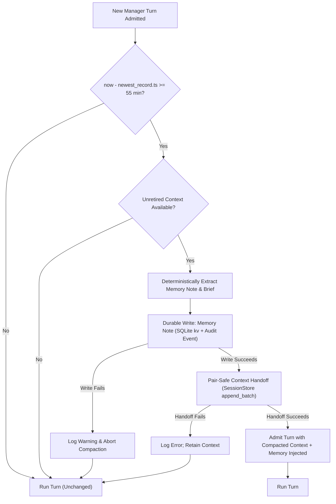

# Plan 10: Manager Automatic Compaction and Machine Memory

Status: proposed (2026-10-23). Concise and actionable architectural plan for automatic, durable lazy compaction and machine memory isolation for the Nexus Manager session. Extends Plan 02 ([`plans/in-progress/02-manager-session-orchestration.md`](../in-progress/02-manager-session-orchestration.md)), [`docs/manager.md`](../../docs/manager.md), and Plan 01 ([`plans/in-progress/01-unified-sessions-and-handoffs.md`](../in-progress/01-unified-sessions-and-handoffs.md)).

---

## 0. Current Evidence and Source Audit (checked 2026-10-23)

1. **Current compaction is deterministic and in-prompt only, or root-oriented handoff**:
   - Compaction in `nexus/context/compact.py:1-450` implements strategies (`drop_oldest`, `evict_tool_results`, `summarize`, `hybrid`) that deterministically discard messages or tool outputs in memory during prompt assembly; it does not persist a durable milestone across restarts and is inherently lossy.
   - Handoff in `nexus/session/handoff.py:17-145` performs durable context cutover via `SummaryRecord` and `context.handoff` `EventRecord`, retiring messages before `boundary`.
   - `build_brief()` in `nexus/context/handoff.py:84-150` is specifically written for regular root coding sessions: it extracts file edits (`Write`/`Edit` in lines 138-139), active shell jobs (`open_shell_jobs` in lines 107-110, 127), and worktree paths (line 127). None of these exist in the Manager session, which runs no shell, no file tools, and no worktrees.
   - Conversely, `build_brief()` completely ignores Manager-specific entities: managed roots (`session.linked`), routed messages (`manager.routed`), launch refusals (`manager.launch_refused`), wait results (`manager.wait`), and inspected reports (`manager.result_read`).

2. **No manager memory path exists**:
   - `_manager_for_turn()` in `nexus/runtime.py:1352-1375` constructs the iteration assembler with `memory_text=""`, `soul_text=""`, `agents_text=""`, and overrides the environment with `system_override=MANAGER_PROMPT` and `summarizer=None`.
   - In `nexus/context/manager.py:2492-2498`, `_render_system()` short-circuits whenever `env.system_override` is non-empty:
     ```python
     if env.system_override is not None:
         self._last_included_parts = (
             {"system_override": env.system_override}
             if env.system_override.strip()
             else {}
         )
         return env.system_override
     ```
     Consequently, even if `memory_text` were passed, it is completely ignored during system prompt rendering for the Manager.
   - `_ManagerAssembler._stamp()` in `nexus/runtime.py:279-298` only appends the `Current user message id (pass as origin_message_id): m<seq>` hint to `system`; it has no memory seam.
   - Human-owned memory lives in `<workspace>/MEMORY.md` (`nexus/config/schema.py:146`). The Manager must never read or write this file.

3. **Manual handoff is refused for Manager**:
   - Host facade explicitly refuses manual handoff for the Manager session: `nexus/host/facade.py:1985` (`self._refuse_manager(command.session, "manual handoff")`).
   - TUI client explicitly documents: `nexus/ui_support/manager.py:31` (`"/handoff": "The manager cannot be handed off"`).
   - Plan 02 settled contract ([`plans/in-progress/02-manager-session-orchestration.md:92`](../in-progress/02-manager-session-orchestration.md#L92)): `| Compaction | plan 01 handoff, deterministic brief only (no summary call, so no second model) |`.

4. **Durable storage primitives already exist**:
   - Durable log records in SQLite `records` table (`nexus/session/db.py:246-255`) store `(project_id, namespace, session_id, seq, kind, ts, body)`. The index on primary key enables fast, single-row lookup of the newest durable record timestamp:
     `SELECT ts FROM records WHERE project_id=? AND namespace=? AND session_id=? ORDER BY seq DESC LIMIT 1`.
   - `SessionStore.kv_set` and `kv_get` (`nexus/session/db.py:1933-1950`) store transactional key-value pairs in SQLite table `kv` (`nexus/session/db.py:267-270`), scoped by `(project_id, namespace, key)`.

5. **Turn admission lifecycle**:
   - Turn admission flows from `Supervisor.submit()` (`nexus/host/supervisor.py:186`) -> `Supervisor._pump()` (`nexus/host/supervisor.py:374`) -> `Supervisor._start()` (`nexus/host/supervisor.py:407`) -> `Session.start_turn()` (`nexus/session/session.py:2919`) -> `Session._prepare_turn()` (`nexus/session/session.py:2621`).
   - `_prepare_turn()` synchronously claims `lease = self.begin_turn(...)` and persists `input.consumed` events.
   - `session.handoff(...)` (`nexus/session/handoff.py:17`) requires an exclusive session lock when called outside an active turn (`_within_turn=False`), or requires the turn lease when called inside (`_within_turn=True`).

---

## 1. Intent and Architectural Rationale

The Manager session is a persistent singleton (`nexus-manager` in namespace `main`) that lives for the lifetime of the workspace. As users launch tasks, check statuses, and relay instructions over hours and days, the Manager's active log grows without bound. If left uncompacted, it exhausts context windows, bloats token usage, and increases latency.

### 1.1 Why Lazy Compaction at Turn Admission (>= 55 min)?

We evaluate three potential triggers:

| Strategy | Mechanism | Pros | Cons | Decision |
|---|---|---|---|---|
| **Model-callable tool** | Model calls e.g. `session_compact()` | Explicit LLM control | Model may fail to call it, call it hallucinatively, or lose track; prompt injection via `<session_result>` could trigger malicious context erasure; breaks Manager 8-tool structural catalog | **Rejected** |
| **In-memory background timer** | `asyncio.sleep` / periodic ticker | Proactive background cleanup | Violates durable-first principle; state lost on daemon restart; spins daemon and wakes idle sessions with no user present; races with concurrent input arrival | **Rejected** |
| **Durable lazy compaction at turn admission** | Evaluated when admitting next turn if `now - newest_durable_ts >= 55 min` | 100% durable across daemon restarts; zero background compute when idle; synchronous with turn lease boundary; fail-safe | **Preferred** |

**Why 55 minutes?**
Codex context cache windows and human working session boundaries typically follow 30–60 minute idle decay patterns. A 55-minute threshold cleanly captures natural session breaks (e.g. human returns after lunch or the next morning) while avoiding disruptive context shifts during active conversational bursts.

### 1.2 Non-Goals for v1
- Generative secondary-model summarization: Manager model is pinned to `codex/gpt-6-luna`; no secondary model is invoked.
- Modifying human-owned `<workspace>/MEMORY.md`.
- Changing regular root or child session compaction paths.
- Interactive user confirmation dialogs for automatic compaction.

---

## 2. Core Invariants and Target Contracts

### Invariant 1: First Durable Memory Write, Then Pair-Safe Handoff (Fail-Safe Ordering)
Compaction must write and fsync/commit the extracted machine memory note before initiating context retirement.
- If the memory note write fails (disk full, SQLite lock error, constraint violation): **abort compaction immediately**. Do not retire context. The incoming turn runs on uncompacted context.
- Context retirement occurs only after memory durability is guaranteed.



### Invariant 2: Isolated Manager Machine Memory
Manager memory is machine-managed and strictly isolated from human-owned `<workspace>/MEMORY.md`.
- Stored transactionally in SQLite `kv` table under key `manager_machine_memory` for `(project_id, namespace="main")`.
- Audit record emitted to Manager log: `manager.memory_updated` containing content digest, char count, and retired sequence range.
- Human-owned `MEMORY.md` remains untouched.

### Invariant 3: Deterministic Extraction in v1
Extraction is purely programmatic, deterministic, secret-redacted, and bounded:
- Extracts managed sessions launched (`session.linked`, `kind="managed"`), their final outcomes, and agent roles.
- Extracts routed links and targets (`manager.routed`).
- Extracts latest human constraints and preferences addressed directly to the Manager from real user messages (`m<seq>`).
- Redacts secrets using `redact_secrets()`.
- Caps memory note strictly to bounds (e.g. max 4,000 chars) using structured section fitting.

### Invariant 4: Dual Injection Path
Because Manager bypasses the general `_render_system` path (due to `system_override = MANAGER_PROMPT`), memory is injected through two cooperative channels:
1. **Runtime System Seam**: In `_ManagerAssembler._stamp()` (`nexus/runtime.py:279`), read `store.kv_get("manager_machine_memory")` and append a structured `## Manager Memory (machine notes)` block to `system`.
2. **Active Context Handoff Brief**: The `SummaryRecord` brief generated by `handoff()` forms the first message of `active_messages()`.

### Invariant 5: Pair-Safe Message Boundary
Context handoff must cut over cleanly at the boundary before the incoming turn's new messages, ensuring:
- `boundary <= read.next_seq + 1`
- No pending `ToolUse` is split from its `ToolResult`.
- Handoff executes under session lock prior to turn start (`_within_turn=False`), or immediately within turn preparation under `TurnLease` (`_within_turn=True`).

---

## 3. Detailed Component Design

### 3.1 Manager Memory Extractor (`nexus/manager/memory.py` or `nexus/context/manager_memory.py`)

A pure, deterministic extraction module:
```python
def extract_manager_memory(
    records: Sequence[SessionRecord],
    existing_memory: str = "",
    *,
    max_chars: int = 4000,
) -> str:
    """Extract structured, bounded, secret-redacted machine memory from Manager log.
    
    Extracts:
    1. Active & recently completed managed root sessions (id, role, title, status).
    2. Routed message links and targets.
    3. User directives / preferences from valid user prompts (m<seq>).
    """
```

**Memory Note Format**:
```markdown
# Manager Memory (machine generated)
## Managed Sessions
- s_abc123 [build] "Fix flaky tests" -> completed
- s_def456 [task] "Refactor parser" -> running

## Relay Links
- Routed to s_xyz789 (2 messages)

## Active Directives & Constraints
- User prefers offline verification before git operations.
```

### 3.2 Manager Handoff Brief Builder

Complementing root session `build_brief()`, a Manager-specialized brief builder:
```python
def build_manager_brief(
    messages: Sequence[Message],
    handle: Any,
    boundary: int,
    memory_note: str,
) -> str:
    """Build a deterministic handoff brief tailored to Manager operations."""
```
- Replaces empty shell/file sections with manager activity summaries (launches, status checks, wait outcomes).
- Embeds references to the durable history sequence range: `Earlier history: this session, seq 1..{boundary - 1} (not deleted)`.
- Sanitized with `safe_brief()` and fitted within `MAX_BRIEF_CHARS` (6000 chars).

### 3.3 Turn Admission Compaction Hook

In `nexus/session/session.py` (during `start_turn` before `_prepare_turn`):
```python
async def _maybe_lazy_compact_manager(self) -> None:
    if self.kind != "manager":
        return
    
    # 1. Check newest durable record timestamp
    newest = self._store.read_tail(self._id, max_records=1).records
    if not newest:
        return
    last_ts = newest[-1].ts
    now = time.time()
    
    idle_limit = self._config_idle_compaction_seconds() # default 55 * 60
    if (now - last_ts) < idle_limit:
        return
        
    # 2. Check if there are active messages to retire
    messages, seqs = self.active_messages()
    if not seqs or len(seqs) <= 1:
        return

    # 3. Deterministic memory extraction
    read_result = self.read(force=True)
    existing_mem = self._store.kv_get("manager_machine_memory") or ""
    new_mem = extract_manager_memory(read_result.records, existing_memory=existing_mem)
    
    # 4. Durable memory write FIRST
    try:
        self._store.kv_set("manager_machine_memory", new_mem)
        self.append_event(Event(
            type="manager.memory_updated",
            session=self._id,
            data={
                "chars": len(new_mem),
                "digest": hashlib.sha256(new_mem.encode()).hexdigest()[:16],
                "through_seq": read_result.next_seq,
            }
        ))
    except Exception as exc:
        logger.warning(f"Manager memory write failed; skipping handoff: {exc}")
        return

    # 5. Context handoff SECOND
    try:
        brief = build_manager_brief(messages, self, read_result.next_seq + 1, new_mem)
        self.handoff(summary=brief, reason="idle_timeout", _within_turn=False)
    except Exception as exc:
        logger.error(f"Manager handoff failed after memory write: {exc}")
```

### 3.4 Runtime Prompt Stamping

In `nexus/runtime.py` `_ManagerAssembler._stamp()` (lines 280-297):
```python
# In addition to the existing user message ID hint:
manager_mem = session._store.kv_get("manager_machine_memory") if session else None
if manager_mem and isinstance(system, str):
    system = f"{system}\n\n## Manager Memory\n{manager_mem}"
```
This guarantees the pinned Codex model receives the up-to-date machine memory in every turn without breaking the packaged `MANAGER_PROMPT` constant.

---

## 4. Concurrency, Restarts, Idempotency, and Failure Modes

1. **Busy Turn and Race Handling**:
   - The admission check runs under `self._lock.exclusive()` before a turn starts (`_within_turn=False`).
   - If a Manager turn is currently running or waiting (`session_wait`), no new turn is admitted, and compaction does not run.
   - When multiple user inputs are queued in FIFO, the first admitted turn executes compaction and updates the durable log timestamp. Subsequent inputs admitted immediately after see `(now - last_ts) < 55 min` and will not trigger compaction.

2. **Daemon Restarts**:
   - Compaction state is zero in-memory.
   - On daemon restart, when the first request is enqueued to the Manager, `_maybe_lazy_compact_manager()` queries SQLite `records` table for `last_ts`. If the daemon was down for 2 hours, the first turn admission immediately detects the >55 min gap and performs memory extraction and handoff cleanly before running the turn.

3. **Request Idempotency & Deduplication**:
   - Handoff uses `submission_digest` and `request_id` tracking in SQLite `submissions` table (`nexus/session/handoff.py:28-37`).
   - If a duplicate submission or client retry occurs, `previous()` returns the canonical receipt without creating a second handoff record.

4. **Failure Recovery**:
   - Memory write failure -> Handoff aborted -> Active context preserved -> Turn runs on uncompacted context.
   - Handoff failure -> Memory note remains saved in SQLite `kv` -> Turn runs on uncompacted context -> Next admission can retry handoff.
   - Database read failure -> Compaction skipped -> Turn proceeds safely.

---

## 5. Configuration, Compatibility, and Migration

### 5.1 Configuration Schema

Add to `ManagerSection` in `nexus/config/schema.py:1236`:
```python
class ManagerSection(msgspec.Struct, frozen=True, forbid_unknown_fields=True):
    enabled: bool = False
    max_launches_per_turn: int = 3
    max_live_managed: int = 8
    auto_compaction: bool = True
    idle_compaction_minutes: int = 55

    def __post_init__(self) -> None:
        ...
        if type(self.auto_compaction) is not bool:
            raise ValueError("manager.auto_compaction must be a boolean")
        if type(self.idle_compaction_minutes) is not int or not 5 <= self.idle_compaction_minutes <= 1440:
            raise ValueError("manager.idle_compaction_minutes must be an integer from 5 to 1440")
```

Layer resolution in `nexus/config/layers.py`:
- `NEXUS_MANAGER__AUTO_COMPACTION`: bool
- `NEXUS_MANAGER__IDLE_COMPACTION_MINUTES`: int

### 5.2 Legacy and Migration Compatibility
- With `manager.enabled = false` (default), no manager code or compaction executes.
- Existing `nexus-manager` sessions in SQLite upgrade transparently: on first admission with the feature enabled, if `last_ts` >= 55m, compaction runs automatically.
- No SQLite schema migration is required: `records` and `kv` tables already support this.

---

## 6. Verification Plan and Test Matrix

### 6.1 Test Suite Structure
Create `tests/test_manager_compaction.py`:
1. `test_manager_compaction_triggers_after_55_minutes`:
   - Seed manager log with 10 turns.
   - Backdate newest record timestamp to `now - 3301s`.
   - Admit turn; assert `manager.memory_updated` and `context.handoff` events appended.
   - Verify active context reduced to brief + new user message.
2. `test_manager_compaction_skips_when_active_under_threshold`:
   - Seed manager log with record timestamp `now - 600s`.
   - Admit turn; assert no handoff occurs; active context unchanged.
3. `test_manager_compaction_failsafe_on_memory_write_failure`:
   - Mock `kv_set` to raise `sqlite3.OperationalError`.
   - Admit turn; assert handoff was NOT called and active context remains intact.
4. `test_manager_memory_isolation_from_workspace_memory_md`:
   - Run compaction with dirty `<workspace>/MEMORY.md`.
   - Assert `<workspace>/MEMORY.md` timestamp and content are untouched.
   - Assert `kv_get("manager_machine_memory")` contains valid machine notes.
5. `test_manager_compaction_pair_safe_boundary`:
   - Verify handoff boundary never splits pending tool use and tool result.
6. `test_manager_compaction_survives_daemon_restart`:
   - Simulate restart by tearing down runtime and reopening database.
   - Verify first turn admitted correctly detects elapsed time and compacts.
7. `test_manager_prompt_stamping_injects_memory`:
   - Verify `_ManagerAssembler._stamp()` includes `## Manager Memory` when machine memory is present.

### 6.2 Verification Commands
```sh
.venv/bin/python -m pytest -q tests/test_manager_compaction.py
.venv/bin/python -m pytest -q tests/test_manager_*.py tests/test_session_handoff.py tests/test_context_handoff.py
.venv/bin/python -m pytest -q tests/test_layering.py tests/test_ui_layering.py
ruff check nexus tests
```

---

## 7. Acceptance Criteria Checklist

- [ ] Automatic compaction runs lazily upon next Manager turn admission when idle time since newest durable record is >= `manager.idle_compaction_minutes` (default 55).
- [ ] No in-memory background timers or model-callable compact tools are introduced.
- [ ] Memory-note durable write strictly precedes context handoff; handoff is aborted if memory write fails.
- [ ] Manager machine memory is stored in SQLite `kv` table and Manager audit events, completely isolated from `<workspace>/MEMORY.md`.
- [ ] Memory extraction is deterministic, secret-redacted, and bounded in v1 without invoking a second model.
- [ ] Memory is injected into the Manager prompt via `_ManagerAssembler._stamp` and into the active context via the handoff brief.
- [ ] Handoff respects pair-safe tool call boundaries and request idempotency.
- [ ] Compaction state survives daemon restarts without timer drift or amnesia.
- [ ] Offline test suite passes and docs (`docs/manager.md`, `docs/decisions.md`, `docs/config.md`) are updated to reflect the new contract.
