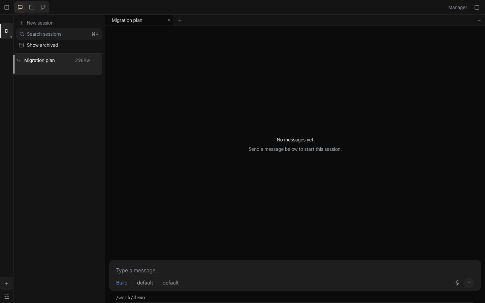

# NSH row menu and rail controls (2026-11-25)

Two rendering corrections, checked against the TUI's anchored popovers and cell-based rail.

## Row menu

The NSH session row's ⋯ button opened a controlled `nsh/base` `ContextMenu`. On desktops
that component anchors at a pointer position filled only by a context-menu event, so a
button or Shift+F10 opening left the point at `(0,0)` and the menu appeared in the top-left
corner. The button and keyboard path now use an anchored `Menu` (`placement="bottom"`,
`align="end"`); right click and long press keep `ContextMenu` at the pointer. The group-tab
⋯ menu had the same controlled pattern and now uses the same anchored `Menu`.

| File | What it shows |
| --- | --- |
| `nsh-row-menu-button-dark.png` | Clicking the row's ⋯ opens the menu under the row, right-aligned to its control. |
| `nsh-row-menu-keyboard-dark.png` | Shift+F10 on the focused row opens the same anchored menu. |
| `nsh-row-menu-right-click-dark.png` | Right click still opens at the pointer. |
| `tui-rail-dark.png` / `.txt` | The TUI's cell-based rail reference. |

## Rail controls

`RAIL_PX` stays at its pre-existing 40 px, and the pinned `+` and Settings controls are
39 px square instead of full-width 72 px rows. 39 px is the rail's 40 px width less its
1 px border, so each control fits inside the rail without overflowing. A pixel check of
`nsh-rail-dark.png` versus `nsh-rail-add-hover-dark.png` gives the hovered control a
39 × 39 px fill.

## Commands

- NSH: `node scripts/nsh-web.mjs test --target web --filter "session menu comes" App.test.tsx`,
  `node scripts/nsh-web.mjs test --target web i6.test.tsx`,
  `node scripts/nsh-web.mjs test --target web layout-ui.test.tsx`, `nsh check`.
- TUI: `tools/shots.sh` seeded frames; the existing
  `the_row_menu_is_a_raised_popover_beside_the_row_and_delete_asks_to_confirm` test remains the
  placement check.

The NSH test captures use the real web renderer with fixture data. The repository's seeded
`e2e/up.sh` + `e2e/shots.mjs` pass was attempted but blocked by the onboarding overlay in the
current working tree, so the paired TUI frame comes from `tools/shots.sh` and the NSH frames
from the web test host.
